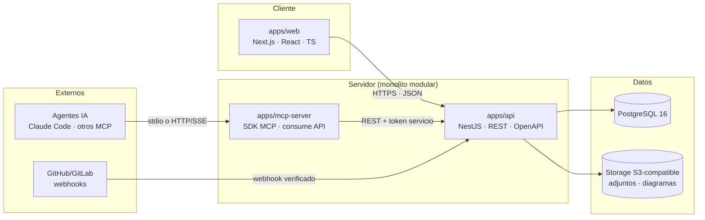

# 03 · Arquitectura técnica

> Cada decisión indica: **Estado** (✅ Confirmada por el prompt · 🔷 Propuesta · ⏳ Pendiente) y alternativas evaluadas. La lista consolidada está en [09-riesgos-y-decisiones.md](09-riesgos-y-decisiones.md).

## 1. Criterios de selección (del prompt §7)

Simplicidad · mantenibilidad · modularidad · seguridad · extensibilidad · bajo costo operativo · buen soporte TypeScript · **evitar microservicios** · arquitectura **modular** con límites claros frontend/backend/integraciones · PostgreSQL como primera alternativa.

## 2. Vista general



**Principios:** (1) el dominio vive en `apps/api`; web es presentación + BFF fino. (2) MCP es un _cliente más_, no contiene dominio. (3) Ningún componente habla con PostgreSQL directamente salvo la API. (4) Toda integración externa pasa por `integrations` + scopes.

## 3. Estructura de monorepo (D-011 🔷)

```
repo/
├── apps/
│   ├── web/            # Next.js (App Router) — UI + BFF mínimo (cookies/auth)
│   ├── api/            # NestJS — dominio, REST, OpenAPI, jobs
│   └── mcp-server/     # @modelcontextprotocol/sdk — herramientas/recursos/prompts
├── packages/
│   ├── db/             # esquema Drizzle, migraciones, seeds, cliente
│   ├── shared/         # tipos, zod schemas, errores RFC 9457, constantes
│   ├── ui/             # componentes React compartidos (árbol, ficha, tabla)
│   └── config/         # tsconfig, eslint, prettier compartidos
├── docs/planificacion/ # estos documentos
└── muckup/             # referencia UX aprobada (intocable)
```

pnpm workspaces + Turborepo · Node ≥ 22 LTS · commits convencionales · versionado por `changesets`.

## 4. Decisiones por componente

### 4.1 Framework frontend — **Next.js 15 (App Router) + React 19** · D-002 🔷

| Alternativa            | A favor                                                                                                                              | En contra                                                                   | Veredicto     |
| ---------------------- | ------------------------------------------------------------------------------------------------------------------------------------ | --------------------------------------------------------------------------- | ------------- |
| **Next.js**            | TS-first, RSC reduce JS al cliente (árbol grande), ecosistema, ruta BFF para auth por cookies, despliegue simple (Node o standalone) | Curva RSC; versión major estable reciente                                   | **Propuesta** |
| Remix / React Router 7 | Modelo mental simple, loaders                                                                                                        | Menor ecosistema; sin ventaja decisiva                                      | Descartada    |
| SvelteKit              | Menos JS, excelente DX                                                                                                               | Rompe el criterio "todo TypeScript + React team skill"; contratación y libs | Descartada    |
| Angular                | Completo enterprise                                                                                                                  | Sobre-ingeniería para equipo pequeño                                        | Descartada    |

_Justificación funcional:_ vistas orientadas a productividad con árboles y tablas densas; SSR + virtualización para `M-02`; pestañas de ficha como rutas anidadas con `searchParams` (compartibles).

### 4.2 Framework backend — **NestJS 11 (monolito modular)** · D-002 🔷

| Alternativa    | A favor                                                                                                                                  | En contra                                                                        | Veredicto                                                       |
| -------------- | ---------------------------------------------------------------------------------------------------------------------------------------- | -------------------------------------------------------------------------------- | --------------------------------------------------------------- |
| **NestJS**     | Módulos/DI alineados con límites M-xx; validación con zod/class-validator; OpenAPI (`@nestjs/swagger`); testing maduro; guards para RBAC | Más ceremonia que Fastify "a pelo"                                               | **Propuesta**                                                   |
| Fastify + tRPC | Menor superficie, end-to-end types                                                                                                       | Sin módulos/DI estructurados; disciplina de límites queda al equipo; aprendizaje | Descartada para API pública (MCP necesita REST estable, no RPC) |
| Hono           | Ultraligero, agnóstico                                                                                                                   | Ecosistema joven para dominio complejo                                           | Descartada                                                      |
| Express        | Universal                                                                                                                                | Sin estructura; mantenimiento a largo plazo                                      | Descartada                                                      |

_Justificación funcional:_ el monolito modular _obliga_ a respetar los límites M-xx (módulos NestJS con APIs internas explícitas), cumpliendo §7 "Evalúa inicialmente una arquitectura modular" y evitando microservicios prematuros.

### 4.3 Base de datos — **PostgreSQL 16** · D-003 ✅ (confirmada por prompt §7)

Alternativas evaluadas y por qué no: **MySQL/MariaDB** (inferior en tipos, FTS, ltree, jsonb maduro — lo decisivo es `ltree` + jsonb + tsvector), **SQLite** (inadecuado para concurrencia multiusuario y ltree), **MongoDB** (sacrificaría integridad referencial — inaceptable por §8 del prompt), **MariaDB** (LTS pero ecosistema inferior en extensiones).
Extensiones: `pgcrypto`/`uuid-ossp` (uuidv7 vía aplicación), `ltree` (árbol), `pg_trgm` + `unaccent` (búsqueda tolerante), `btree_gin` (índices compuestos parciales).

### 4.4 ORM / acceso SQL — **Drizzle ORM** · D-004 🔷

| Alternativa    | A favor                                                                                                                                     | En contra                                                                                          | Veredicto                                      |
| -------------- | ------------------------------------------------------------------------------------------------------------------------------------------- | -------------------------------------------------------------------------------------------------- | ---------------------------------------------- |
| **Drizzle**    | SQL-first (predecible para ltree/CTE), tipado estricto sin generación de cliente, migraciones versionadas en SQL (revisables en PR), ligero | Menos "magia"; joins explícitos                                                                    | **Propuesta**                                  |
| Prisma         | Mejor DX inicial, Studio                                                                                                                    | Abstracción sobre SQL dificulta ltree/CTE/recursivas; migraciones menos auditables; N+1 silencioso | Descartada                                     |
| Kysely         | Query builder impecable, cero magia                                                                                                         | Sin capa de esquema/migración integrada (añadir `kysely-ctl`); más piezas                          | Alternativa válida si Drizzle no encaja en POC |
| SQL crudo (pg) | Control total                                                                                                                               | Pierde tipado y productividad en CRUD masivo                                                       | Descartada                                     |

_ADR-009_ del mockup referenciaba esta decisión; aquí queda **propuesta** y deberá confirmarse en Fase 1 con un spike de 2 días (árbol + relaciones polimórficas).

### 4.5 Autenticación — **better-auth (sesiones en DB) + tokens de servicio** · D-008 🔷 · PP-003/PP-004 ⏳

| Alternativa                                                                                                      | Veredicto                                                                     |
| ---------------------------------------------------------------------------------------------------------------- | ----------------------------------------------------------------------------- |
| **better-auth** (email+contraseña, sesiones persistidas en PG, adapter disponible, TS-first, hooks de auditoría) | **Propuesta**                                                                 |
| Auth.js v5                                                                                                       | Potente pero acoplado a Next.js; queremos validez fuera de web (API, MCP CLI) | Descartada como núcleo |
| Implementación propia                                                                                            | Control total, coste de seguridad alto                                        | Descartada             |
| JWT puro sin sesiones                                                                                            | Revocación imposible — inaceptable para acciones de agentes                   | Descartada             |

Humanos: sesión server-side (`HttpOnly`, `SameSite=Lax`, rotación cada 7 días). Agentes/integraciones: **service token** por producto (hash en DB, scopes, expiración, revocación, rate-limit). Autorización: Guards NestJS + verificación `product_id` + `permissions` por rol; defensa en profundidad: `WHERE product_id = $1` siempre; RLS como endurecimiento opcional Fase 2+ (PP-009-análoga no bloquea v1).

### 4.6 Editor Markdown — **CodeMirror 6 + remark/rehype preview** · D-012 🔷

| Alternativa                                 | Veredicto                                                                                                                                                                           |
| ------------------------------------------- | ----------------------------------------------------------------------------------------------------------------------------------------------------------------------------------- |
| **CodeMirror 6 + vista previa renderizada** | **Propuesta** — Markdown explícito > WYSIWYG para specs técnicos; bundle menor; licencia MIT; extensible (lint, hover de códigos `PANT-02` con preview de la ficha — diferenciador) |
| TipTap (WYSIWYG sobre ProseMirror)          | Excelente pero WYSIWYG oculta la fuente; más peso; reconsiderable si PP-005 lo pide                                                                                                 |
| Milkdown                                    | Middle-ground ProseMirror+Markdown; menos maduro                                                                                                                                    |

Adjuntos/diagramas: storage S3-compatible; en desarrollo, filesystem en `./data/uploads` con misma interfaz `StoragePort` (S3 SDK) → MinIO en Compose para paridad.

### 4.7 Gestión de archivos — **StoragePort + S3 SDK; local en dev, S3/MinIO en prod** · RE-007 ☁️

Interfaz única `StoragePort { put, getSignedUrl, delete }`; ningún módulo escribe en disco directamente. Límites: 15 MB/fichero, MIME allowlist (png/jpg/webp/svg sanitizado, pdf, txt, md, log, har, csv). SVG sanitizado (DOMPurify) antes de servir. Servido siempre con `Content-Disposition: attachment` salvo imágenes seguras.

### 4.8 Comunicación en tiempo real — **SSE unidireccional; sin WebSocket en v1** · D-013 🔷

Usos: badge de actividad, timeline en vivo, kanban multi-cliente (revalidación por evento). SSE sobre HTTP con cookies funciona tras proxies simples y es suficiente para 1 producto/50 usuarios. WebSocket re-evaluarable si se añade edición colaborativa (SU-008 la excluye de v1).

### 4.9 API — **REST + OpenAPI 3.1 + RFC 9457** · ✅ estilo confirmado por prompt (REST, AGENTS consumen API)

Diseño: recursos plurales, códigos legibles públicos (`M01`, `PANT-02`, `TAR-231`), paginación cursor, `Idempotency-Key` en escrituras de agentes, errores `problem+json`, validación zod compartida con web (`packages/shared`), versionado `/api/v1`, rate-limit por token. GraphQL descartada: superficie de autorización difusa y cacheo complejo para este dominio (decisión revisable con datos de uso reales).

### 4.10 Integración MCP — **SDK oficial `@modelcontextprotocol/sdk` (TypeScript)** · D-009/D-010 ✅

Especificación completa, catálogo de herramientas, recursos, prompts y auditoría: [06-integraciones-agentes.md](06-integraciones-agentes.md). Puntos estructurales: MCP consume la API (token de servicio); v1 read-only (`list/get/search/get_product_context` + historial), v2 escrituras con confirmación humana explícita para `register_change`, `resolve_issue`, publicación de docs. Transporte: `stdio` para Claude Code local y HTTP/SSE para agente remoto; mismo servidor, dos transportes.

### 4.11 Sistema de pruebas — **Vitest + Testing Library + Supertest + Playwright** · detalle en [08](08-estrategia-pruebas.md)

Unit/integration con Postgres real efímero (testcontainers) · contratos API contra OpenAPI (schemathesis opcional) · component TL · E2E Playwright (flujos críticos: crear producto, árbol, ficha, kanban, MCP read-only) · suites dedicadas: permisos, tenant-escape, integridad de relaciones, migraciones up/down.

### 4.12 Infraestructura y despliegue — **Docker Compose self-host primero; SaaS-compatible** · PP-002 ⏳

- **v1 objetivo (propuesto):** 1 VM (2 vCPU / 4 GB) con Docker Compose: `web`, `api`, `mcp-server`, `postgres:16`, `minio` (opcional), `caddy` (TLS). Backup diario `pg_dump` + retención 14 días. Coste ≈ 8–15 €/mes.
- **Pipeline:** GitHub Actions → lint + typecheck + test + build + imagen Docker → deploy opcional vía SSH/Compose o Coolify/Kamal (a decidir en PP-002).
- **SaaS futuro:** Postgres gestionado (Neon/RDS), object storage gestionado, tier por organización; esquema multi-tenant ya preparado (aislamiento lógico por `org/product`; evaluar RLS o bases separadas solo cuando haya > 50 tenants — no prematuro).
- **Observabilidad mínima:** logs estructurados (pino) JSON → stdout; healthcheck `/api/v1/health`; métricas RED básicas vía `api/metrics` (Prometheus opcional). Sin APM comercial en v1.

## 5. Límites modulares y reglas de dependencia

```
apps/web  ──HTTP──▶ apps/api ──ORM──▶ PostgreSQL
apps/mcp-server ──HTTP──▶ apps/api
apps/api ──S3 SDK──▶ StoragePort
packages/shared (tipos/zod) ◀── web, api, mcp-server
packages/db ◀── api (único consumidor del esquema)
packages/ui ◀── web (y Storybook ligero opcional)
```

**Prohibido:** web importa `packages/db`; mcp-server importa cualquier paquete salvo `shared` y SDK; cualquier módulo de dominio salta al de otro (todo vía servicios internos con transacción); SQL en controladores.

## 6. Seguridad (resumen; matriz completa en [04](04-modelo-datos.md) §10 y [05](05-experiencia-usuario.md) §8)

- Toda tabla de dominio: `product_id NOT NULL`; FKs compuestas `(id, product_id)` cuando el hijo referencia al padre → cross-tenant imposible por construcción.
- Guards por defecto "deny"; permisos declarados por endpoint (`@Permissions('docs:publish')`).
- Secretos: `.env` no versionado; en prod, secretos del orquestador; rotación de service tokens con doble clave (active/retiring).
- Adjuntos: MIME allowlist + magic-bytes + SVG sanitizado + `Attachment` header.
- Auditoría: `activity_log` append-only incluso para Administrador global (ni borrado ni edición).
- Rate-limit: por sesión y por token (token bucket en Redis opcional; en v1, limiter en memoria + límite por nginx/caddy).
- Backups: cifrados, fuera del host de aplicación.

## 7. Rendimiento y escalabilidad previstos

| Escenario                   | Diseño                                                                               |
| --------------------------- | ------------------------------------------------------------------------------------ |
| Árbol de 5.000 nodos        | SSR + `ltree` indexado + virtualización cliente (`@tanstack/virtual`)                |
| Búsqueda full-text          | `tsvector` español + `pg_trgm`, índice GIN, "did you mean"                           |
| Relaciones "qué afecta a X" | Índice `(target_kind, target_id)`; resolución en un solo SELECT con UNION ALL tipado |
| Timeline de producto        | Paginación cursor sobre `activity_log(product_id, created_at DESC)`                  |
| 50 usuarios/producto        | Stateless API (2 réplicas detrás de caddy), sesiones en PG, sin affinity             |

## 8. Riesgos tecnológicos principales

Detalle y mitigaciones: [09-riesgos-y-decisiones.md](09-riesgos-y-decisiones.md). Top-3: (R-01) complejidad del modelo polimórfico de relaciones; (R-02) seguridad de la superficie MCP/agentes; (R-03) alcance de v1 (6 áreas grandes). Por eso la **Fase 1 no incluye funcionalidad**: valida cimientos (repo, auth, esquema, árbol mínimo) antes de construir.

## 9. Lo que deliberadamente NO se usa en v1

Microservicios · Kubernetes · CQRS/Event Sourcing · GraphQL · WebSockets · CRDT · colas (BullMQ) — ninguna se descarta para siempre; se descartan para v1 por falta de necesidad demostrable (RE-003). La arquitectura deja puertos (StoragePort, IntegrationPort, EventPort no-op) para introducirlas sin reescritura.
