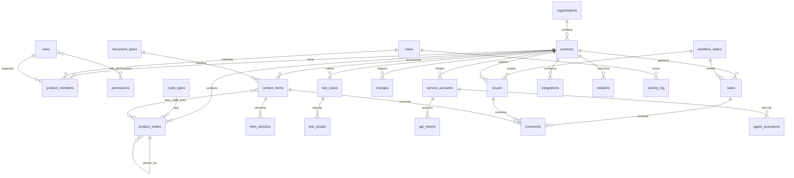

# 04 · Modelo de datos

> Complementa a [03-arquitectura-tecnica.md](03-arquitectura-tecnica.md). Las 16 entidades iniciales del prompt §8 están todas presentes y **ampliadas** con 12 entidades adicionales (justificadas). Convención: PK interna `uuid` (UUIDv7, ordenables); código legible opcional (`code`) por producto; toda tabla de dominio lleva `product_id NOT NULL`.

## 1. Convenciones globales

- **Tipos:** `uuid` PKs; `timestamptz` con `now()` por defecto; `text` (no `varchar(n)`); `jsonb` para estructuras débiles; `boolean` siempre con default.
- **Multiproducto por construcción:** las relaciones padre→hijo llevan FKs **compuestas** `(id, product_id)`; un hijo nunca puede referenciar a un padre de otro producto. Guard de aplicación + constraints DB.
- **Borrado:** soft-delete (`deleted_at`) en nodos/documentos/tareas; **append-only** en `activity_log`, `item_versions`, `agent_executions` (sin UPDATE/DELETE; revocado por trigger a todos los roles salvo migración).
- **Enumeraciones** como `text` + `CHECK` (más migrable que `ENUM` nativo).
- **Versionado de esquema:** migraciones Drizzle versionadas en `packages/db/migrations/`, aplicadas con `migrate` en CI/CD, `up/down` probados (ver [08](08-estrategia-pruebas.md) §9).

## 2. Entidades iniciales (16) → destino

| Entidad del prompt | Decisión                                                                                                                                             |
| ------------------ | ---------------------------------------------------------------------------------------------------------------------------------------------------- |
| products           | ✅ `products`                                                                                                                                        |
| product_members    | ✅ `product_members` (+ `invited_at`, `accepted_at`)                                                                                                 |
| product_nodes      | ✅ `product_nodes` (+ `ltree path`, `deleted_at`, `code`)                                                                                            |
| node_types         | ✅ `node_types` (global + configurables por producto)                                                                                                |
| node_relations     | 🔷 Integrada en `relations` polimórfica (ver §6) — se mantienen vistas `node_relations` / `item_relations` para compatibilidad con la lista original |
| content_items      | ✅ `content_items` (supertipo documental)                                                                                                            |
| item_relations     | 🔷 Ídem (vista sobre `relations`)                                                                                                                    |
| item_versions      | ✅ `item_versions` (inmutable)                                                                                                                       |
| comments           | ✅ `comments` (polimórfico con trigger)                                                                                                              |
| attachments        | ✅ `attachments`                                                                                                                                     |
| users              | ✅ `users` (gestionada por better-auth)                                                                                                              |
| roles              | ✅ `roles` (4 fijos + extensible)                                                                                                                    |
| permissions        | ✅ `permissions` + `role_permissions`                                                                                                                |
| activity_log       | ✅ `activity_log` (append-only)                                                                                                                      |
| integrations       | ✅ `integrations`                                                                                                                                    |
| agent_executions   | ✅ `agent_executions`                                                                                                                                |

## 3. Entidades adicionales identificadas (12)

| Nueva entidad                     | Por qué es necesaria                                                                                                   |
| --------------------------------- | ---------------------------------------------------------------------------------------------------------------------- |
| `document_types`                  | Los 13 tipos documentales + `adr` como catálogo configurable (no enum) — §5.3 pide tipos "considerados", no cerrados   |
| `workflow_states`                 | Estados configurables de tareas/incidencias por producto (§5.4) — no cabe en enum fijo                                 |
| `state_transitions`               | Transiciones controladas con origen/destino y permiso requerido — requisito explícito §5.4                             |
| `changes`                         | Registro de modificaciones (§5.6): estados propuesta/ejecutada, refs Git — entidad de primer orden, no un content_item |
| `test_cases`                      | "Funcionalidades sin pruebas" (§5.8) y MCP `list_test_cases`/`register_test_result` requieren entidad propia           |
| `test_results`                    | Ejecuciones (humano o agente) vinculadas a caso, nodo de contexto y agente — auditoría §5.9                            |
| `service_accounts`                | Identidad de agentes/integraciones separada de `users` — §5.9 "diferencia acciones humanas de automatizadas"           |
| `api_tokens`                      | Tokens de servicio con hash, scopes, expiración, revocación — §9, MCP §5                                               |
| `node_closure` _(opcional)_       | Fallback/medida si `ltree` no está disponible (PP-009) o para analítica de subárboles                                  |
| `item_node_links`                 | N:M explícita documento↔nodo (un doc a varios nodos; un nodo varios docs) — §5.3                                       |
| `product_objectives`              | Objetivo de producto como entidad ordenada con estado — §5.1 "descripción y objetivos" con seguimiento                 |
| `schema_migrations` / `seed_runs` | Metadatos operativos de migraciones y seeds (trazabilidad del propio esquema)                                          |

## 4. Entidades principales — atributos

### 4.1 Identidad y organización

**products**

| Columna                            | Tipo                                                               | Notas                          |
| ---------------------------------- | ------------------------------------------------------------------ | ------------------------------ |
| id                                 | uuid PK (v7)                                                       |                                |
| slug                               | citext UNIQUE                                                      | `kanora`                       |
| name                               | text NOT NULL                                                      |                                |
| tagline, description               | text                                                               |                                |
| status                             | text CHECK in (`active`,`in_development`,`maintenance`,`archived`) | §5.1                           |
| tech_stack                         | jsonb `string[]`                                                   | `["Next.js","NestJS",…]`       |
| repo_url                           | text                                                               |                                |
| icon, color                        | text                                                               | UI                             |
| org_id                             | uuid NOT NULL → organizations                                      | Preparado para SaaS (ver nota) |
| created_at, updated_at, deleted_at | timestamptz                                                        | soft-delete                    |

> Nota multi-tenant: se añade `organizations` aunque la v1 use una sola org ("Acme & Co"); evita migración destructiva futura (D: SaaS-ready, §3.1). Cada `product` pertenece a exactamente una `organization`.

**product_members** — `(product_id, user_id)` PK compuesta, `role_id FK`, `invited_at`, `accepted_at`, `created_at`. **Cardinalidad:** un usuario puede ser miembro de N productos; su rol es por producto (§9).

**users** — gestionada por better-auth: `id, email (unique), name, email_verified, created_at, updated_at, image`. Campos propios: `actor_type` no aplica aquí (ver activity_log).

**roles** — fija (4): `admin_global` (alcance organización, sin fila en product_members necesaria), `admin_product`, `collaborator`, `viewer`. `permissions` catálogo (`docs:read`, `docs:write`, `docs:publish`, `tasks:write`, `issues:write`, `changes:propose`, `changes:execute`, `members:manage`, `config:manage`, `integrations:manage`, `audit:read`, `agent:confirm` …). `role_permissions` N:M.

### 4.2 Árbol funcional

**node_types** — `id, product_id NULL (global sembrado) | NOT NULL (personalizado), key (`modulo`…), label, color, icon, is_structural bool, position, deleted_at`. Semilla v1: modulo, submodulo, pantalla, pestana, componente, proceso, servicio, otro.

**product_nodes**

| Columna                            | Tipo                                                                | Notas                                                         |
| ---------------------------------- | ------------------------------------------------------------------- | ------------------------------------------------------------- |
| id                                 | uuid PK (v7)                                                        |                                                               |
| product_id                         | uuid NOT NULL → products                                            |                                                               |
| parent_id                          | uuid NULL → product_nodes(id, product_id)                           | FK compuesta                                                  |
| node_type_id                       | uuid NOT NULL → node_types                                          |                                                               |
| code                               | text NOT NULL                                                       | `PANT-02` único por producto: UNIQUE `(product_id, code)`     |
| name                               | text NOT NULL                                                       |                                                               |
| description                        | text NULL                                                           | descripción funcional breve (ficha · Resumen, migración 0008) |
| objective                          | text NULL                                                           | objetivo funcional (ficha · Funcionalidad, migración 0008)    |
| path                               | `ltree NOT NULL`                                                    | materializa jerarquía (ver §5)                                |
| depth                              | int NOT NULL DEFAULT 0                                              |                                                               |
| position                           | int NOT NULL                                                        | hermano orden                                                 |
| status                             | text CHECK (`planned`,`in_progress`,`done`,`deprecated`,`disabled`) |                                                               |
| owner_id                           | uuid NULL → users                                                   | responsable funcional                                         |
| created_at, updated_at, deleted_at | timestamptz                                                         | desactivar = soft-delete                                      |

**Restricciones:** un nodo raíz tiene `parent_id IS NULL`; mover = transacción: actualizar parent+path en todo el subárbol (UPDATE recursivo acotado). **Cero ciclos** validado antes de aplicar (DFS). **Índice único parcial** `(product_id, code) WHERE deleted_at IS NULL`.

### 4.3 Elementos documentales

**content_items** — supertipo de los 13 tipos documentales + ADR.

| Columna                            | Tipo                                                    | Notas                                                                                |
| ---------------------------------- | ------------------------------------------------------- | ------------------------------------------------------------------------------------ |
| id                                 | uuid PK (v7)                                            |                                                                                      |
| product_id                         | uuid NOT NULL                                           |                                                                                      |
| doc_type_id                        | uuid NOT NULL → document_types                          | kind funcional (`spec`,`use_case`,`business_rule`,`api_contract`,`adr`,`test_doc`,…) |
| code                               | text                                                    | `DOC-101` opcional, único por producto                                               |
| title                              | text NOT NULL                                           |                                                                                      |
| body_markdown                      | text NOT NULL DEFAULT ''                                | fuente de verdad (no HTML)                                                           |
| status                             | text CHECK (`draft`,`in_review`,`published`,`archived`) | publicación controlada                                                               |
| scope                              | text CHECK (`node`,`global`) DEFAULT 'node'             | documentación global del producto (§5.1)                                             |
| version                            | int NOT NULL DEFAULT 1                                  | espejo denormalizado de item_versions                                                |
| search_tsv                         | tsvector GENERATED                                      | índice GIN (búsqueda)                                                                |
| created_by, updated_by             | uuid → users                                            |                                                                                      |
| created_at, updated_at, deleted_at | timestamptz                                             |                                                                                      |

**item_versions** — `id, item_id → content_items (ON DELETE RESTRICT), version int, title, body_markdown, author_id, change_note, created_at`. UNIQUE `(item_id, version)`. **Inmutable**: trigger prohíbe UPDATE/DELETE.

**item_node_links** — `(item_id, node_id)` PK compuesta + `product_id`. **item_document_links** no existe: documento↔documento usa `relations`.

### 4.4 Trabajo: tareas, incidencias, cambios, pruebas

**tasks** — `id, product_id, code (`TAR-231`), title, description, type CHECK (`development`,`analysis`,`documentation`,`maintenance`), state_id → workflow_states, priority CHECK (`critical`,`high`,`medium`,`low`), assignee_id → users NULL, estimate_minutes int NULL, acceptance_criteria jsonb (checklist), due_date date NULL, created_by, created_at, updated_at, completed_at, deleted_at`. Índices: `(product_id, state_id)`, `(product_id, assignee_id) WHERE completed_at IS NULL`, `(product_id, due_date)`.

**issues** — `id, product_id, code (`INC-087`), title, description, expected_behavior, observed_behavior, reproduction_steps text[], severity CHECK (`critical`,`high`,`medium`,`low`), priority, state_id, assignee_id, reopen_count int DEFAULT 0, created_by, created_at, updated_at, resolved_at, deleted_at`.

**changes** — `id, product_id, code (`MOD-031`), kind CHECK (`functional`,`technical`), status CHECK (`proposed`,`executed`), description, git_repo, git_branch, git_sha, git_pr_url, git_files jsonb, executed_at, created_by, created_at, updated_at`. Los vínculos (incidencias resueltas, docs modificadas, nodos afectados, decisiones) viven en `relations` — **no** columnas repetidas por relación.

**test_cases** — `id, product_id, code (`TC-014`), title, type CHECK (`manual`,`automated`,`e2e`), status, created_at, deleted_at`. **test_results** — `id, test_case_id, product_id, status CHECK (`passed`,`failed`,`skipped`), environment, notes, executed_by_kind (`human`,`agent`), executed_by uuid NULL (users) | service_account_id NULL, agent_execution_id → agent_executions NULL, executed_at`.

### 4.5 Relaciones y comentarios

**relations** — pieza central del modelo (ver §6).

| Columna       | Tipo                                                                                                                                                                                      | Notas                                                 |
| ------------- | ----------------------------------------------------------------------------------------------------------------------------------------------------------------------------------------- | ----------------------------------------------------- |
| id            | uuid PK (v7)                                                                                                                                                                              |                                                       |
| product_id    | uuid NOT NULL                                                                                                                                                                             | siempre; nunca relaciones entre productos             |
| source_kind   | text NOT NULL CHECK in (`node`,`item`,`task`,`issue`,`change`,`test_case`,`decision`=item)                                                                                                |                                                       |
| source_id     | uuid NOT NULL                                                                                                                                                                             | sin FK fís. cross-kind; integridad por trigger (§7)   |
| target_kind   | text NOT NULL (mismo catálogo)                                                                                                                                                            |                                                       |
| target_id     | uuid NOT NULL                                                                                                                                                                             |                                                       |
| relation_type | text NOT NULL CHECK in (`affects`,`documents`,`specifies`,`implements`,`resolves`,`blocks`,`is_blocked_by`,`verifies`,`depends_on`,`relates_to`,`modifies`,`references`,`applies_rule`,…) | Catálogo inicial extensible; apenas 12–15 suficientes |
| metadata      | jsonb                                                                                                                                                                                     | p. ej. `{"note": "…"}`                                |
| created_by    | uuid                                                                                                                                                                                      |                                                       |
| created_at    | timestamptz                                                                                                                                                                               |                                                       |

UNIQUE `(product_id, source_kind, source_id, target_kind, target_id, relation_type)` — idempotencia natural (importaciones, agentes con retry). Índices: `(target_kind, target_id)`, `(source_kind, source_id)`, `(product_id, relation_type)`.

**comments** — `id, product_id, parent_kind CHECK (`item`,`task`,`issue`,`change`), parent_id uuid, author_id, body, created_at, updated_at, deleted_at`. Trigger valida existencia del padre en su tabla.

**attachments** — `id, product_id, owner_kind, owner_id, storage_key, filename, mime_type, size_bytes, sha256, uploaded_by, created_at, deleted_at`. Trigger igual.

### 4.6 Actividad y agentes

**activity_log** — append-only. `id, product_id NULL (evento de org), actor_type CHECK (`human`,`agent`,`system`), actor_user_id NULL, actor_service_account_id NULL, action (`task.created`, `doc.version_published`, `relation.added`, `change.executed`, …), entity_kind, entity_id, summary text, metadata jsonb, ip inet NULL, created_at`. Trigger: `BEFORE UPDATE OR DELETE → RAISE`.

**agent_executions** — `id, product_id, service_account_id, agent_name (`claude-code`, …), tool_name, request_summary, status CHECK (`ok`,`error`,`confirmation_required`,`rejected`), idempotency_key UNIQUE, duration_ms, created_at`. Entrada completa o resumen + hash (no volcar secretos).

**integrations** — `id, product_id, kind CHECK (`mcp`,`rest`,`git`,`webhook_out`,`markdown_export`,`cli`), name, config jsonb (sin secretos: referencias a env/secret manager), status CHECK (`connected`,`active`,`available`,`disabled`,`error`), created_by, created_at`.

**service_accounts** — `id, product_id, name, agent_kind, created_by, created_at, disabled_at`. **api_tokens** — `id, service_account_id, token_hash (sha256), scopes text[], expires_at, last_used_at, revoked_at, created_at`.

**workflow_states** — `id, product_id, scope CHECK (`task`,`issue`), key, label, color, position, is_terminal bool`. **state_transitions** — `id, product_id, scope, from_state_id NULL (inicial), to_state_id, required_permission text NULL, requires_confirmation bool DEFAULT false`.

## 5. Implementación del árbol jerárquico

| Enfoque                         | Pros                                                            | Contras                                                          | Veredicto                      |
| ------------------------------- | --------------------------------------------------------------- | ---------------------------------------------------------------- | ------------------------------ |
| Nested sets (lft/rght)          | Lectura de subárbol O(1)                                        | Movimientos/inserciones O(n); bloqueos; frágil con concurrencia  | Descartada                     |
| Adyacencia simple (`parent_id`) | Simple; movimientos baratos                                     | Subárbol = CTE recursivo (ok con índice pero coste por consulta) | Necesaria pero no suficiente   |
| Materialized path `ltree`       | Subárbol `path <@ 'a.b'` indexado (GiST); orden estable; barato | Requiere `CREATE EXTENSION ltree`; reescritura de path en moves  | **Propuesta**                  |
| Closure table                   | Sin extensión; integridad FK pura                               | Doble escritura; tabla extra; más código                         | Plan B si PP-009 rechaza ltree |

**Propuesta:** adyacencia (`parent_id`) **+** `ltree path` mantenido en servicio de dominio (`TreeService.move()` en una transacción). Moves son eventos raros y administrativos; el coste O(subárbol) es asumible y atómico con `serializable`. Para `node_closure` se documenta como alternativa (mismo servicio podría emitirla después).

## 6. Relaciones polimórficas vs modelos relacionales explícitos

**Problema:** hay que relacionar pares heterogéneos: tarea↔pantalla, regla↔caso de uso, incidencia↔modificación, doc↔nodo, change↔incidencia, caso de prueba↔tarea. Construir una tabla puente por cada par multiplicado (~10 kind × ~10 kind / 2 = ~50 tablas) es ingobernable; un polimorfismo puro "sin FK a ningún sitio" sagrifica integridad referencial (prohibido por §8).

**Comparación:**

| Enfoque                                                       | Integridad referencial               | Coste                                          | Consultabilidad bidireccional  | Veredicto                                           |
| ------------------------------------------------------------- | ------------------------------------ | ---------------------------------------------- | ------------------------------ | --------------------------------------------------- |
| N tablas puente explícitas (`task_nodes`, `issue_items`, …)   | FK reales                            | Explosión combinatoria, migraciones constantes | Buena                          | Descartada (escala mal con nuevos kinds)            |
| Polimorfismo puro (`entity_type`, `entity_id`) sin checks     | Ninguna (huérfanos silenciosos)      | Mínimo                                         | Excelente                      | Descartada (viola §8)                               |
| **`relations` unificada + triggers de validación por `kind`** | **Garantizada por trigger (ver §7)** | Una tabla, un índice dual                      | **Excelente (un solo índice)** | **Propuesta**                                       |
| Tabla `entities` superpágina (todo tiene fila ahí)            | FK reales a superpágina              | Doble transacción en cada alta; JPQL feo       | Excelente                      | Alternativa documentada; descartada por simplicidad |

El diseño propuesto conserva los nombres del prompt: vistas `node_relations` y `item_relations` como `SELECT … WHERE source_kind='node'` etc., para no romper la referencia mental del documento original.

**Trigger de integridad (pseudológica):** antes de INSERT/UPDATE en `relations`, según `source_kind` ejecutar `SELECT 1 FROM <tabla_del_kind> WHERE id = source_id AND product_id = NEW.product_id`; si no existe → excepción. Lo mismo para target. Además: prohibido `source = target`; prohibido duplicado exacto; los kinds válidos vía CHECK. Resultado: **0 huérfanos garantizados** aunque la aplicación falle. Pruebas dedicadas en [08](08-estrategia-pruebas.md) §6.

## 7. Diagrama ER (entidades principales)



`relations` no tiene FKs físicas (por diseño polimórfico); su integridad está descrita en §6–§7. `comments`/`attachments` tampoco (mismo mecanismo de trigger).

## 8. Índices y rendimiento

- `product_nodes`: GiST sobre `path`; UNIQUE parcial `(product_id, code) WHERE deleted_at IS NULL`; `(parent_id, position)`.
- `content_items`: GIN `search_tsv`; `(product_id, doc_type_id, status)`; UNIQUE `(product_id, code) WHERE deleted_at IS NULL`.
- `relations`: dual `(source_kind, source_id)`, `(target_kind, target_id)`; `(product_id, relation_type)`.
- `tasks` / `issues`: `(product_id, state_id)`; parciales abiertas. `activity_log`: `(product_id, created_at DESC)`.
- `item_versions`: `(item_id, version DESC)` cubre "última versión".
- `test_results`: `(test_case_id, executed_at DESC)`.

## 9. Consultas críticas (diseño)

Las 7 de §5.7 del prompt, expresadas sobre `relations`:

```sql
-- ¿Qué tareas afectan esta pantalla? (source=task → target=node:PANT-02)
SELECT t.* FROM relations r JOIN tasks t ON t.id = r.source_id
WHERE r.product_id = $1 AND r.target_kind='node' AND r.target_id = $2
  AND r.source_kind='task' AND r.relation_type IN ('affects','implements');
```

Las seis restantes son la misma forma con (kind, relation_type) distintos. `get_product_context` (MCP §6) usa una CTE que recolecta nodos relacionados + docs + reglas + CU + tareas abiertas + incidencias abiertas + cambios recientes en una pasada.

## 10. Matriz de autorización (resumen; detalle en [05](05-experiencia-usuario.md) §8)

| Permiso                                                | Admin global | Admin producto |     Colaborador     | Consulta |
| ------------------------------------------------------ | :----------: | :------------: | :-----------------: | :------: |
| Gestionar productos / org                              |      ✅      |       ❌       |         ❌          |    ❌    |
| Miembros del producto / integraciones                  |      ✅      |       ✅       |         ❌          |    ❌    |
| Editar configuración (tipos, estados)                  |      ✅      |       ✅       |         ❌          |    ❌    |
| Crear/editar nodos, docs, tareas, incidencias, cambios |      ✅      |       ✅       |         ✅          |    ❌    |
| Publicar documento / ejecutar cambio (MOD)             |      ✅      |       ✅       | ✍️ solo con permiso |    ❌    |
| Leer todo                                              |      ✅      |       ✅       |         ✅          |    ✅    |
| Confirmar acciones de agentes (agent:confirm)          |      ✅      |       ✅       |         ❌*         |    ❌    |

\* Configurable por producto (PP-006).

## 11. Reglas de integridad y limpieza

1. **Append-only:** `activity_log`, `item_versions`, `agent_executions`, `test_results`.
2. **Soft-delete** en `product_nodes`, `content_items`, `tasks`, `issues`, `changes` (columna `deleted_at`); las `relations` se conservan (el elemento sigue en el historial); política de purga GDPR opcional futura anonimiza actores, nunca borra historia.
3. **Huérfanos:** barrido semanal `relations` LEFT JOIN por kind; métrica `orphan_relations` alerta si > 0.
4. **Slugs/códigos** inmutables tras uso (evita romper enlaces `/kanora/nodes/PANT-02`).
5. **Cascadas:** `ON DELETE RESTRICT` desde hijos a padres (nunca `CASCADE` en dominio); borrado de producto solo por Administrador global + doble confirmación + backup previo.
6. **Consistencia de denormalizaciones:** `content_items.version` se actualiza solo dentro de `publishVersion()` en transacción.

## 12. Escalabilidad esperada

≤ 10 productos × ≤ 5.000 nodos × ≤ 50.000 documentos × ≤ 200.000 relations: árbol `ltree` < 5 ms por subárbol; relaciones por índice dual < 2 ms; búsqueda FTS GIN < 50 ms. El crecimiento a SaaS (cientos de tenants) requerirá particionado de `activity_log` por mes y posiblemente tabla `relations` particionada por `product_id` — no necesario en v1; los `product_id` en todo facilitan `LIST PARTITION BY product_id` posterior sin reescritura.
