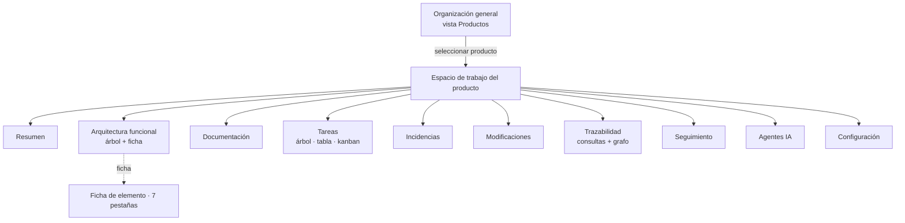

# 05 · Experiencia de usuario

> **Referencia obligatoria:** el mockup aprobado [`../../muckup/`](../../muckup/) es la fuente de verdad visual y de navegación de este documento. Esta sección define contratos de comportamiento, no reinventa el diseño. Las 12 vistas del mockup se implementan en Fase 1–6 según [07](07-plan-implementacion.md).

## 1. Principios de diseño (§6 prompt + §3 mockup)

1. **Navegación por producto y arquitectura funcional** como eje; el tablero es una vista, no el centro.
2. **Ficha integral por elemento** con pestañas adaptadas (Resumen · Funcionalidad · Documentación · Tareas · Incidencias · Relaciones · Historial).
3. **Tablas, listas y jerarquías** antes que tarjetas y gráficos: densidad informativa, decisión rápida.
4. **Una sola fuente de datos por vista**; nada duplicado entre árbol/tabla/kanban (misma consulta, distinto `view`).
5. **Humanos y agentes visibles:** toda acción lleva badge `HUMANO` / `AGENTE IA`.
6. **Accesibilidad:** WCAG 2.1 AA; foco visible; navegación completa por teclado; `Ctrl/Cmd+K` como paleta universal; lecturas de estado (`aria-live`) en kanban y toasts.

## 2. Mapa de navegación



**Sidebar** (persistente, 264 px): org switcher + contexto de producto, secciones "Organización", "Producto · <nombre>" y "Sistema". En modo org, las entradas de producto desaparecen y se muestra banner de aislamiento (implementado en mockup). **Topbar:** breadcrumb `Org › Producto › Vista` + buscador global (paleta) + notificaciones + avatar.

## 3. Catálogo de pantallas

Cada pantalla del mockup con: propósito, operaciones, permisos (matriz §8) y endpoint principal.

| #   | Vista (mockup)             | Propósito / responsabilidades                                                                 | Operaciones clave                                                                    | API principal                     |
| --- | -------------------------- | --------------------------------------------------------------------------------------------- | ------------------------------------------------------------------------------------ | --------------------------------- |
| 1   | **Productos**              | Estado transversal de la organización; alta y navegación a espacios                           | listar, crear, filtrar, abrir espacio                                                | `GET/POST /products`              |
| 2   | **Resumen**                | Ficha raíz del producto: objetivos, stack, repo, integrantes, actividad, documentación global | ver actividad, saltar a docs globales, ir a configuración                            | `GET /products/:id` + `/activity` |
| 3   | **Arquitectura funcional** | Árbol configurable + ficha integral; crear/mover/duplicar/desactivar nodos                    | seleccionar, expandir, filtrar tipo, mover (dnd), duplicar, CRUD nodo                | `/nodes/*`                        |
| 3a  | Ficha → pestañas           | Contexto completo del elemento (código, estado, responsable, avance)                          | cambiar pestaña, adjuntar doc/tarea, reportar incidencia, ver relaciones e historial | `/nodes/:id/*`, `/relations`      |
| 4   | **Documentación**          | Biblioteca tipada con vista previa Markdown y versionado                                      | filtrar tipo/estado, buscar, abrir, editar, ver versiones, exportar                  | `/documents/*`                    |
| 5   | **Tareas**                 | Trabajo vinculado al árbol; 3 representaciones                                                | cambiar vista, filtrar, crear, transicionar estado, dependencias                     | `/tasks/*`                        |
| 6   | **Incidencias**            | Errores reproducibles; maestro-detalle                                                        | filtrar severidad, crear, vincular tarea/MOD, verificar                              | `/issues/*`                       |
| 7   | **Modificaciones**         | Registro de cambios propuesta/ejecutada con refs Git                                          | filtrar estado, registrar, vincular elementos, ver commits                           | `/changes/*`                      |
| 8   | **Trazabilidad**           | 7 consultas canónicas + grafo de relaciones del elemento                                      | ejecutar consulta, navegar a elemento relacionado                                    | `/trace/*`, `/relations`          |
| 9   | **Seguimiento**            | Estado del producto en tablas y listas                                                        | filtrar actividad, ir a elementos sin doc/prueba/bloqueados                          | `/products/:id/overview`          |
| 10  | **Agentes IA**             | Auditoría y gobierno de integraciones/agentes                                                 | ver operaciones, ejecuciones, estado MCP, configurar                                 | `/integrations/*`, `/agents/*`    |
| 11  | **Configuración**          | Miembros/roles, tipos de nodo, estados de tarea, integraciones                                | invitar, cambiar rol, añadir tipo, editar transiciones, toggles                      | `/config/*`                       |
| 12  | **Mapa del sistema**       | Sitemap navegable con referencias §al prompt                                                  | navegar                                                                              | estático (documento de UX)        |

## 4. La ficha integral del elemento (contrato)

**Cabecera:** tipo (icono+color), código (`PANT-02`), nombre, ruta (`Operaciones / … / Asignación de pedidos`), estado, responsable, acciones `Editar · Historial`.

**Pestañas (visibilidad por tipo):**

| Pestaña                                                                                                                                                                        | Contenido                                                                         | Tipos que la muestran                                               |
| ------------------------------------------------------------------------------------------------------------------------------------------------------------------------------ | --------------------------------------------------------------------------------- | ------------------------------------------------------------------- |
| Resumen                                                                                                                                                                        | Descripción, estado, responsable, avance, últimas versiones, cobertura de pruebas | Todos                                                               |
| Funcionalidad                                                                                                                                                                  | Objetivo, casos de uso, reglas de negocio, RNF, flujos                            | Módulo, Submódulo, Pantalla, Pestaña, Componente, Proceso, Servicio |
| Documentación                                                                                                                                                                  | Lista de docs del nodo + adjuntar                                                 | Nodos estructurales y Componente                                    |
| Tareas                                                                                                                                                                         | Tareas vinculadas + crear                                                         | Todos los nodos                                                     |
| Incidencias                                                                                                                                                                    | Incidencias vinculadas + reportar                                                 | Todos los nodos                                                     |
| Relaciones                                                                                                                                                                     | Entrantes/salientes con tipo y contraparte navegable                              | Todos                                                               |
| Historial                                                                                                                                                                      | Timeline unificada (humano/agente) con enlaces a MOD/docs                         | Todos                                                               |
| _No aplican_: un Proceso/Servicio no muestra "Funcionalidad" de pantalla; un Componente no muestra "Casos de uso" como raíz. La visibilidad se define en `node_types.ui_tabs`. |

**Contador en cada pestaña** (nº de docs/tareas/incidencias/relaciones) — ya presente en mockup.

## 5. Flujos clave

### 5.1 Alta de producto a primera pantalla visible

```
Productos → [+ Nuevo producto] → form (nombre, tagline, descripción, stack, objetivos)
→ backend crea product + semilla node_types/estados/integración MCP (disabled) + product_members(admin)
→ redirección a Resumen → call-to-action "Crear primer módulo" (vacio-state amable)
```

### 5.2 De definición funcional a desarrollo (el diferenciador)

```
M-02 crear Pantalla (PANT-xx) → abrir doc Especificación funcional vinculada
→ publicar versión → vincular caso de uso y regla de negocio
→ crear tareas TAR-xxx vinculadas → kanban del nodo
→ agente (MCP) lee get_product_context(PANT-xx) → propone implementación
→ MOD propuesta por agente (PENDING confirmación) → humano ejecuta/aprueba
→ tests registrados por agente (register_test_result) → cobertura de DOC-118 pasa a ✓
```

### 5.3 Triage de incidencia → cierre con trazabilidad completa

```
INC-087 reportada (esperado/observado/pasos/evidencias) vinculada a PANT-02
→ agente o humano crea TAR correctiva → MOD-031 (status=proposed) → PR #418
→ webhook Git vincula commit/PR a MOD-031 → ejecutada
→ INC → Verificada (transición) → activity_log enlaza todo; historia consultable por pantalla
```

### 5.4 Onboarding de agente (Claude Code)

```
Configuración → Integraciones → activar MCP para Kanora → genera service token (scopes: lectura)
→ operador copia comando `claude mcp add devcycle --token …` → agente ejecuta get_product_context
→ visible en Agentes IA → ejecución auditada con actor=agent
→ para escrituras: admin habilita scopes de escritura + modo confirmación (PP-006)
```

## 6. Comportamientos y detalles

- **Comandos (`Ctrl/Cmd+K`):** navega a vistas, nodos, docs y tareas por código o texto (implementado en mockup; portado a producción con mismas fuentes).
- **Estados vacíos guiados** en cada panel (CTA concreto, jamás "no data").
- **Confirmación explícita** en operaciones destructivas o sensibles: desactivar nodo (conservando historial), ejecutar MOD, publicar documento, revocar token, quitar miembro.
- **Densidad:** filas de 32–36 px, tipografía 12–13 px, sin decoración gratuita; impresión/PDF básico via CSS `@media print` en vistas de consulta.
- **Notificaciones:** solo menciones, asignaciones, transiciones que te bloquean, ejecución de MOD por agente, fallos de integración — jamás marketing ni "tips".
- **Offline:** no soportado en v1; errores distinguen "sin conexión" de "sin permisos" (problem+json `type`).

## 7. Design system ligero

Tokens heredados de `muckup/css/styles.css`: paleta sidebar oscura `#0e1424`, acento índigo `#4f46e5`, estados (ok/warn/crit/info), radios 8–10 px, sombras suaves, Inter/system-ui + ui-monospace para códigos. Componentes `packages/ui`: `Tree`, `DataTable`, `KanbanBoard`, `Tabs`, `Timeline`, `Pill`, `ProgressBar`, `EmptyState`, `CommandPalette`, `Toast`. Sin dependencia de librerías de UI pesadas; sin CSS-in-JS (CSS Modules + variables CSS).

## 8. Matriz de autorización por pantalla (RBAC por producto)

| Pantalla / operación                        | Admin global |    Admin producto    |       Colaborador        |  Consulta  |
| ------------------------------------------- | :----------: | :------------------: | :----------------------: | :--------: |
| Ver Productos / métricas org                |      ✅      | (solo sus productos) |     (sus productos)      | ✅ lectura |
| Crear / archivar producto                   |      ✅      |          ❌          |            ❌            |     ❌     |
| Resumen (lectura)                           |      ✅      |          ✅          |            ✅            |     ✅     |
| Árbol: crear/mover/duplicar/desactivar nodo |      ✅      |          ✅          |            ✅            |     ❌     |
| Documentación: crear/editar                 |      ✅      |          ✅          |            ✅            |     ❌     |
| Documentación: publicar / archivar versión  |      ✅      |          ✅          |  ✍️ con `docs:publish`   |     ❌     |
| Tareas: crear/editar/transicionar           |      ✅      |          ✅          |            ✅            |     ❌     |
| Incidencias: crear/editar                   |      ✅      |          ✅          |            ✅            |     ❌     |
| Modificaciones: proponer                    |      ✅      |          ✅          |            ✅            |     ❌     |
| Modificaciones: **ejecutar**                |      ✅      |          ✅          | ✍️ con `changes:execute` |     ❌     |
| Trazabilidad / Seguimiento (lectura)        |      ✅      |          ✅          |            ✅            |     ✅     |
| Agentes: ver auditoría                      |      ✅      |          ✅          |            ❌            |     ❌     |
| Agentes: activar MCP / crear token          |      ✅      |          ✅          |            ❌            |     ❌     |
| Confirmar acción sensible de agente         |      ✅      |          ✅          |       ❌ (PP-006)        |     ❌     |
| Configuración: miembros / integraciones     |      ✅      |          ✅          |            ❌            |     ❌     |

## 9. Responsive y accesibilidad

- ≥ 1280 px: layout completo (sidebar 264 px). 1024–1280: sidebar colapsable a iconos. < 1024 px: sidebar como drawer; árbol/ficha en acordeón; kanban con scroll horizontal; la vista de uso real de la plataforma será escritorio (decisión de producto, no de diseño).
- WCAG 2.1 AA: contraste AA verificado en tokens, foco visible, `role=tree/treeitem`, pestañas con `tablist`, tablas con `<th scope>`, `prefers-reduced-motion` respetado.

## 10. Telemetría de producto (interna)

Eventos (a `activity_log` con `actor_type=system` cuando no hay usuario): `view.opened` (vistas más usadas), `query.trace_executed`, `command_palette.used`, `agent.confirmation_shown/accepted/rejected`. Sin herramientas de analítica de terceros en v1.
