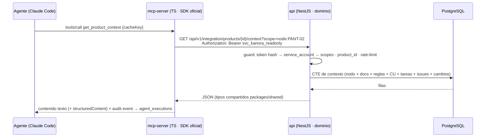

# 06 · Integración con agentes IA y servidor MCP

> Sección ampliada en `prompt.md` (_Integración MCP y herramientas para agentes de programación_). Este documento es el contrato definitivo de la capa: **arquitectura · API · herramientas (32) con contratos · recursos · prompts · autenticación · permisos · auditoría · integración Git · estrategia Claude Code · primera versión mínima**. Nada de esto se implementa antes de la Fase 6.

## 1. Arquitectura



**Componentes y responsabilidades:**

| Componente                           | Responsabilidad                                                                                               | Nunca hace                                               |
| ------------------------------------ | ------------------------------------------------------------------------------------------------------------- | -------------------------------------------------------- |
| **API central** (`apps/api`)         | Dominio, validación, autorización, auditoría, OpenAPI                                                         | Exponer SQL; lógica en controladores                     |
| **Servidor MCP** (`apps/mcp-server`) | Traducir tools/resources/prompts MCP ↔ REST; validar params con zod; mapear errores; transport stdio/HTTP+SSE | Acceder a PostgreSQL; contener dominio; saltarse la API  |
| **Agentes externos**                 | Razonamiento y ejecución de tareas dev                                                                        | Obtener credenciales de BD; actuar sin token de servicio |

El MCP **consume la API** exactamente igual que lo haría el frontend (mismo contrato, mismo enforcement). Diferencias: autenticación por token de servicio (no sesión), `Idempotency-Key` obligatoria en toda escritura del agente, y _scopes_ más estrechos por defecto.

**Por qué servidor separado y no endpoint "/mcp" dentro de la API:** (1) despliegue y escalado independiente (los agentes son bursty); (2) fallo del MCP no tumba la web; (3) el SDK MCP evoluciona rápido: aislamiento de churn; (4) permite ofrecer el binario `devcycle-mcp` como ejecutable a usuarios sin exponer la API entera; (5) claridad de límites para auditorías de seguridad. Coste: un contenedor más (≈ 60 MB) — aceptado.

## 2. Modelo de identidad, autenticación y permisos

### 2.1 Service accounts y tokens

- `service_accounts` por producto: `claude-code`, `ci-bot`, `otro-agente`. Creados por `Administrador de producto`.
- `api_tokens`: `token_hash = sha256(token)`; el token en claro se muestra **una única vez** (patrón GitHub). Campos: `scopes[]`, `expires_at` opcional, `last_used_at`, `revoked_at`.
- Revocación instantánea: guard comprueba `revoked_at IS NULL` en cada request (o cache TTL 30 s).
- Rotación sin downtime: tokens _active/retiring_ (gracia 7 días).

### 2.2 Scopes (permisos por token)

| Scope                                                                           | Permite                                                                    |
| ------------------------------------------------------------------------------- | -------------------------------------------------------------------------- |
| `read:products` / `read:structure`                                              | `list_products`, `get_product*`, `get_node*`, resources                    |
| `read:docs` / `read:tasks` / `read:issues` / `read:changes` / `read:tests`      | Lecturas de cada área                                                      |
| `write:docs` / `write:tasks` / `write:issues` / `write:changes` / `write:tests` | Escrituras (MCP v2)                                                        |
| `changes:propose`                                                               | Proponer MOD (nunca ejecutar sin `agent:confirm` humano)                   |
| `issues:resolve`                                                                | Marcar verificada (sensible)                                               |
| `agent:confirm`                                                                 | Solo humanos lo poseen; un token **no puede** confirmar acciones sensibles |

**Principio:** tokens de solo lectura por defecto. Escrituras = alta explícita por admin + _modo confirmación_ (v2): el agente propone, la API marca `confirmation_required`, un humano aprueba (en UI o con `POST /agents/executions/:id/confirm`), entonces se ejecuta. Sin confirmación → rechazada y auditada.

### 2.3 Confirmaciones para operaciones sensibles

| Operación                                                                       | Modo                                               |
| ------------------------------------------------------------------------------- | -------------------------------------------------- |
| Crear/actualizar documento en estado `published`                                | Confirmación                                       |
| `register_change` (MOD) status=`executed`                                       | Confirmación                                       |
| `resolve_issue`                                                                 | Confirmación                                       |
| Borrar/archivar cualquier cosa                                                  | **Prohibido vía MCP** siempre (solo humanos en UI) |
| Crear tarea, comentar, registrar resultado de prueba, proponer MOD (`proposed`) | Permitido con scope `write:*` sin confirmación     |
| Actualizar estado de tarea a `in_progress/review`                               | Permitido                                          |
| Actualizar estado de tarea a `done`                                             | Confirmación (cierra métricas)                     |

## 3. Catálogo de herramientas MCP (32) — contratos de E/S

Convenciones: params como objeto JSON (zod); salida `structuredContent` + `content[0].text` resumen; errores MCP estándar (`InvalidParams`, `Unauthorized`, `Forbidden`, `NotFound`, `Conflict`, `ConfirmationRequired`); toda tool declara `annotations: { readOnlyHint, destructiveHint, idempotentHint }`. **v1 = solo `readOnlyHint=true`** (16 tools); v2 añade las 16 restantes.

### 3.1 Consulta de producto (6) — v1

| Tool                       | Params                                                                 | Salida (núcleo)                                                                        |
| -------------------------- | ---------------------------------------------------------------------- | -------------------------------------------------------------------------------------- |
| `list_products`            | `{ organizationId? }`                                                  | `[{id, slug, name, status, avance?}]` — solo productos visibles para el token          |
| `get_product`              | `{ productSlug }`                                                      | Ficha: descripción, objetivos, stack, estado, repo, métricas resumen                   |
| `get_product_structure`    | `{ productSlug, depth?, rootNodeCode? }`                               | Árbol de nodos (id, code, type, name, status, children[]) — depth por defecto 2, max 4 |
| `get_node`                 | `{ productSlug, nodeCode }`                                            | Nodo + breadcrumb + tipos + counts (docs/tareas/issues/cambios)                        |
| `search_product_knowledge` | `{ productSlug, query, kinds?, limit? }`                               | Hits FTS tipados (node/item/task/issue/change) ordenados por ts_rank                   |
| `get_product_context`      | `{ productSlug, target: { kind: 'module'\|'node', code }, sections? }` | Contexto empaquetado (ver §6). Tamaño acotado (≤ 32 KB); el agente pide secciones      |

### 3.2 Documentación (6) — 4 read-only en v1 · 2 en v2

| Tool                   | Params                                                                                         | Salida / efecto                                                  |
| ---------------------- | ---------------------------------------------------------------------------------------------- | ---------------------------------------------------------------- |
| `list_documents`       | `{ productSlug, nodeCode?, docType?, status?, limit? }`                                        | `[{id, code, title, docType, version, status, updatedAt}]`       |
| `get_document`         | `{ productSlug, documentCode, version? }`                                                      | Documento completo (Markdown) + metadatos + nodos vinculados     |
| `search_documents`     | `{ productSlug, query, docType?, limit? }`                                                     | Hits con fragmento resaltado                                     |
| `get_document_history` | `{ productSlug, documentCode }`                                                                | Lista versiones: número, autor, fecha, mensaje (sin cuerpos)     |
| `create_document` ✍️v2 | `{ productSlug, nodeCode?, docType, title, body(markdown), status?: 'draft', idempotencyKey }` | `{ code, version: 1 }` — siempre borrador; publicar exige humano |
| `update_document` ✍️v2 | `{ productSlug, documentCode, body, changeNote, expectedVersion, idempotencyKey }`             | Concurrencia optimista: `expectedVersion` ≠ actual → `Conflict`  |

### 3.3 Tareas (6) — 2 v1 · 4 v2

| Tool                      | Params                                                                                                                                     | Salida / efecto                                                      |
| ------------------------- | ------------------------------------------------------------------------------------------------------------------------------------------ | -------------------------------------------------------------------- |
| `list_tasks`              | `{ productSlug, nodeCode?, state?, priority?, assignee?, limit? }`                                                                         | `[{code, title, state, priority, assignee, dueDate}]`                |
| `get_task`                | `{ productSlug, taskCode }`                                                                                                                | Ficha + criterios de aceptación + relaciones                         |
| `create_task` ✍️v2        | `{ productSlug, title, description?, type, priority, nodeCodes[], dueDate?, estimateMinutes?, acceptanceCriteria?, idempotencyKey }`       | `{ code }`                                                           |
| `update_task` ✍️v2        | `{ productSlug, taskCode, patch{ title?, description?, priority?, estimateMinutes?, acceptanceCriteria?, assignee? }, expectedUpdatedAt }` | Requiere match de `expectedUpdatedAt` (optimistic locking)           |
| `update_task_status` ✍️v2 | `{ productSlug, taskCode, toStateKey, note? }`                                                                                             | Validado contra `state_transitions` + permiso; `done` → confirmation |
| `add_task_comment` ✍️v2   | `{ productSlug, taskCode, body }`                                                                                                          | Comentario atribuido al service account (badge AGENTE IA)            |

### 3.4 Incidencias (5) — 2 v1 · 3 v2

| Tool                  | Params                                                                                                       | Salida / efecto                                            |
| --------------------- | ------------------------------------------------------------------------------------------------------------ | ---------------------------------------------------------- |
| `list_issues`         | `{ productSlug, nodeCode?, severity?, state?, limit? }`                                                      | `[{code, title, severity, state}]`                         |
| `get_issue`           | `{ productSlug, issueCode }`                                                                                 | Detalle completo + esperada/observada + pasos + evidencias |
| `create_issue` ✍️v2   | `{ productSlug, title, expectedBehavior, observedBehavior, steps[], severity, nodeCodes[], idempotencyKey }` | `{ code }`                                                 |
| `update_issue` ✍️v2   | `{ productSlug, issueCode, patch{…}, expectedUpdatedAt }`                                                    | Idem locking                                               |
| `resolve_issue` ✍️v2⚑ | `{ productSlug, issueCode, resolutionNote, changeCode?, idempotencyKey }`                                    | **Confirmation-required**; vincular MOD con `resolves`     |

### 3.5 Trazabilidad (6) — 4 v1 · 2 v2

| Tool                    | Params                                                                                                                                           | Salida / efecto                                          |
| ----------------------- | ------------------------------------------------------------------------------------------------------------------------------------------------ | -------------------------------------------------------- |
| `get_node_history`      | `{ productSlug, nodeCode, limit? }`                                                                                                              | Timeline de cambios/docs/estados del nodo                |
| `get_node_relations`    | `{ productSlug, nodeCode, direction?: 'in'                                                                                                       | 'out', relationTypes? }`                                 | Relaciones salientes/entrantes tipadas |
| `get_task_relations`    | `{ productSlug, taskCode }`                                                                                                                      | Nodos, docs, issues, dependencies de la tarea            |
| `get_dependencies`      | `{ productSlug, entity: {kind, code}, depth? }`                                                                                                  | Grafo acotado (≤ 3) de dependencias                      |
| `register_change` ✍️v2⚑ | `{ productSlug, kind, status, description, nodeCodes[], taskCodes[], issueCodes?, documentCodes?, gitRef{repo,branch,sha,pr?}, idempotencyKey }` | status=`proposed` libre; `executed` → confirmation       |
| `link_items` ✍️v2       | `{ productSlug, source{kind,code}, target{kind,code}, relationType, idempotencyKey }`                                                            | Valida existencia en ambos lados (trigger) + tipo válido |

### 3.6 Pruebas (3) — 1 v1 · 2 v2

| Tool                        | Params                                                                                                                              | Salida / efecto                               |
| --------------------------- | ----------------------------------------------------------------------------------------------------------------------------------- | --------------------------------------------- |
| `list_test_cases`           | `{ productSlug, nodeCode?, type?, status? }`                                                                                        | `[{code, title, type, status}]`               |
| `get_test_case`             | `{ productSlug, testCaseCode }`                                                                                                     | Caso + última ejecución + cobertura del CU    |
| `register_test_result` ✍️v2 | `{ productSlug, testCaseCode, status, environment?, notes?, context{nodeCode?,changeCode?}, executedBy?('agent'), idempotencyKey }` | `{ resultId }`; marca cobertura vía relations |

### 3.7 Resumen de versiones de la surface MCP

| Grupo         | v1 (16, read-only) | v2 (+16, writes controladas)                                           |
| ------------- | ------------------ | ---------------------------------------------------------------------- |
| Producto      | 6                  | —                                                                      |
| Documentación | 4                  | `create_document`, `update_document`                                   |
| Tareas        | 2                  | `create_task`, `update_task`, `update_task_status`, `add_task_comment` |
| Incidencias   | 2                  | `create_issue`, `update_issue`, `resolve_issue`⚑                       |
| Trazabilidad  | 4                  | `register_change`⚑, `link_items`                                       |
| Pruebas       | 1 (`list`)         | `get_test_case`*, `register_test_result`                               |

*`get_test_case` es read-only: se adelanta a v1 (→ 17 tools read-only). v1 incluye `get_document_history`, `get_node_history`, `get_node_relations`, `get_task_relations`, `get_dependencies`, `search_product_knowledge`, `get_product_context`.

## 4. Recursos MCP (resources) — URIs estables

Formato `devcycle://{productSlug}/{resource}[/{id}]`. `resources/list` los enumera; `resources/read` devuelve Markdown o JSON (`application/json` con `mimeType` declarado). Cacheables por `ETag`/`updatedAt`.

| URI                                             | Contenido                              |
| ----------------------------------------------- | -------------------------------------- |
| `devcycle://kanora/products`                    | Catálogo de productos visibles (JSON)  |
| `devcycle://kanora/structure`                   | Árbol completo (JSON, lazy children)   |
| `devcycle://kanora/nodes/PANT-02`               | Nodo + breadcrumb + counts             |
| `devcycle://kanora/nodes/PANT-02/context`       | Contexto completo para agente (ver §6) |
| `devcycle://kanora/nodes/PANT-02/documents`     | Docs vinculados al nodo                |
| `devcycle://kanora/nodes/PANT-02/rules`         | Reglas de negocio aplicables           |
| `devcycle://kanora/nodes/PANT-02/decisions`     | ADRs relacionadas                      |
| `devcycle://kanora/nodes/PANT-02/api-contracts` | Contratos API vinculados               |
| `devcycle://kanora/documents/DOC-101`           | Documento Markdown                     |
| `devcycle://kanora/tasks/TAR-231`               | Ficha de tarea                         |
| `devcycle://kanora/changes`                     | Historial de modificaciones reciente   |

Las URIs son **contrato estable**: se publican en `@devcycle/mcp-server` como constantes; un cambio breaking exige nuevo prefijo `devcycle2://`.

## 5. Prompts MCP (reutilizables)

Prompts = plantillas parametrizadas (`prompts/list`, `prompts/get`). Cada una referencia recursos/tools concretos — el agente no inventa flujo:

| Prompt                         | Argumentos                  | Intención                                                                                                |
| ------------------------------ | --------------------------- | -------------------------------------------------------------------------------------------------------- |
| `analyze-screen-before-change` | `nodeCode`                  | Resume qué es, qué reglas/CU/docs/tests tiene PANT-xx y qué puede romperse                               |
| `prepare-implementation`       | `taskCode`                  | Contexto + criterios de aceptación + plan de implementación + puntos de fallo conocidos (de incidencias) |
| `analyze-issue`                | `issueCode`                 | Clasifica, busca duplicadas/relaciones, propone tareas y MOD                                             |
| `review-change`                | `changeCode`                | Revisa una MOD propuesta: alcance, pruebas afectadas, docs que desactualiza                              |
| `update-documentation`         | `nodeCode` o `documentCode` | Detecta drift entre descripción y estado actual; borrador de actualización                               |
| `generate-tests`               | `nodeCode` o `useCaseCode`  | Casos de prueba (unit/e2e) trazados a CU y RN                                                            |
| `verify-acceptance-criteria`   | `taskCode`                  | Checklist ejecutada/verificada contra el diff                                                            |

## 6. Contexto estructurado para agentes (`get_product_context`)

Objetivo: **un solo call** que entregue lo necesario y nada más. Entrada: `{ productSlug, target: nodeCode|moduleCode, sections?: [funcional, docs, rules, useCases, dataModel, apiContracts, pendingTasks, openIssues, decisions, dependencies, history] }` (por defecto: todas excepto `history` completo — resumen).

Salida (JSON acotado, cada sección truncada con `truncated: true` si supera su presupuesto):

```json
{
  "target": {
    "code": "PANT-02",
    "name": "Asignación de pedidos",
    "path": "M01/SM01/PANT-02",
    "status": "in_progress"
  },
  "functional": "Pantalla central de asignación…",
  "documents": [{ "code": "DOC-101", "title": "Especificación funcional…", "version": 7 }],
  "businessRules": [{ "code": "RN-014", "summary": "Reasignación máx. 2 veces" }],
  "useCases": ["CU-014 Asignar pedido a ruta óptima", "CU-015 Reasignar"],
  "apiContracts": [{ "code": "DOC-131", "title": "POST /routes/assign v5" }],
  "openIssues": [{ "code": "INC-087", "severity": "critical" }],
  "pendingTasks": [{ "code": "TAR-231", "state": "in_progress", "priority": "high" }],
  "decisions": [{ "code": "ADR-009", "title": "Drizzle ORM sobre Prisma" }],
  "dependencies": [{ "code": "SVC-02", "kind": "servicio", "relation": "depends_on" }],
  "recentHistory": [{ "date": "2026-11-05", "actor": "agent", "text": "12/12 tests OK (TAR-231)" }]
}
```

Presupuestos: 32 KB totales; `functional` ≤ 4 KB; listas ≤ 10 ítems con `count` real y `truncated`. El agente puede pedir `sections: ["documents"]` para paginar el resto.

## 7. Integración con Git (MCP §7)

- Webhook `push` y `pull_request` → verificación HMAC → endpoint `POST /integration/git/events` (idempotente por `X-GitHub-Delivery`).
- Parser de mensajes: `MOD-031`, `TAR-231`, `INC-087`, `PANT-02` (regex configurable) → crea/vincula `relations` commit↔MOD↔elementos.
- PR mergeado → MOD `proposed → executed` sugerida (confirmada por humano salvo `executed_by=agent` + scope).
- **Nunca**: la integración Git no modifica documentos/tareas directamente — solo propone/vincula. El historial funcional manda (`activity_log`), Git es fuente de evidencia enlazada.

## 8. Seguridad y auditoría (contrato)

1. Todo tool call queda en `agent_executions` con: `service_account_id`, `tool`, argumentos **redactados** (secretos enmascarados), `status`, `duration_ms`, `idempotency_key`.
2. `activity_log` con `actor_type='agent'` enlaza ejecución ↔ entidades resultantes.
3. Rate-limit por token: 120 req/min lectura, 30 req/min escritura (configurable); superado → `429` + audit.
4. Confirmación (`agent:confirm`) es **imposible vía MCP**: el agente pide, la plataforma confirma; ningún token puede auto-asignarse confirmación.
5. Fuera de scope v1: ejecución de comandos arbitrarios, acceso a FS del servidor, lectura de secretos, escrituras masivas.
6. Revisión trimestral de scopes y tokens; alerta si un token de escritura lleva > 30 días sin rotar.

**Ejemplo de interacción completa (agente resuelve incidencia):**

```
Ag: get_issue(INC-087)              → lee esperado/observado/pasos/evidencias
Ag: get_product_context(PANT-02)    → reglas RN-014, CU-014, MOD-031 propuesto
Ag: update_task_status(TAR-231, in_progress)
…implementa…
Ag: register_test_result(TC-014, passed, context={nodeCode:PANT-02})
Ag: register_change({kind:technical, status:proposed, description:"…", nodeCodes:[PANT-02], issueCodes:[INC-087], gitRef:{sha:"a3f9c21"}})
API → confirmation_required (MOD-031 ya existía con mismo contenido → idempotencia → devuelve propuesta existente)
Human: aprueba en UI → MOD-031 ejecutada → INC-087 verificable por flujo estándar
```

## 9. Estrategia de integración con Claude Code

1. `npx @devcycle/mcp-server` (o imagen `devcycle/mcp-server:0.x`) como suproceso stdio de Claude Code:
   `claude mcp add --scope project devcycle -- devcycle-mcp --token svc_… --product kanora`.
2. `.claude/settings.json` de ejemplo generado por la plataforma (Configuración → Integraciones → "Copiar configuración").
3. Contexto por defecto: el agente recibe instrucción de empezar siempre con `get_product_context` del elemento en curso.
4. Tareas escritas por agente llevan badge `AGENTE IA` y son filtrables en kanban ("ocultar trabajo de agentes").
5. Otros clientes MCP (Cursor, OpenCode, Cline, Continue): mismo transporte; sin código específico por cliente.

## 10. Primera versión mínima (MCP v1) — alcance

**Dentro:** transporte stdio; los 17–18 tools read-only (§3.7); resources (solo JSON); prompts (4 de los 7); auth por service token; `agent_executions` + auditoría básica; documentos de usuario "Conectar Claude Code en 5 minutos"; rate-limit en memoria.
**Fuera de v1:** escrituras (v2), HTTP/SSE transport (v1.1 si se pide), resources binarios (imágenes), prompts restantes, panel de métricas de agentes (Seguimiento ya muestra actividad).
**Criterio de done v1:** Claude Code listando `devcycle` con `claude mcp list`, ejecutando `get_product_context` y `search_product_knowledge`, ejecución visible en auditoría, prueba E2E Playwright del flujo.

## 11. Riesgos específicos de esta capa

R-02 (seguridad MCP) y R-08 (confirmación UX) en [09-riesgos-y-decisiones.md](09-riesgos-y-decisiones.md). Mitigaciones: v1 read-only, principio de mínimo scope, confirmación imposible vía token, redacción de argumentos en auditoría.
