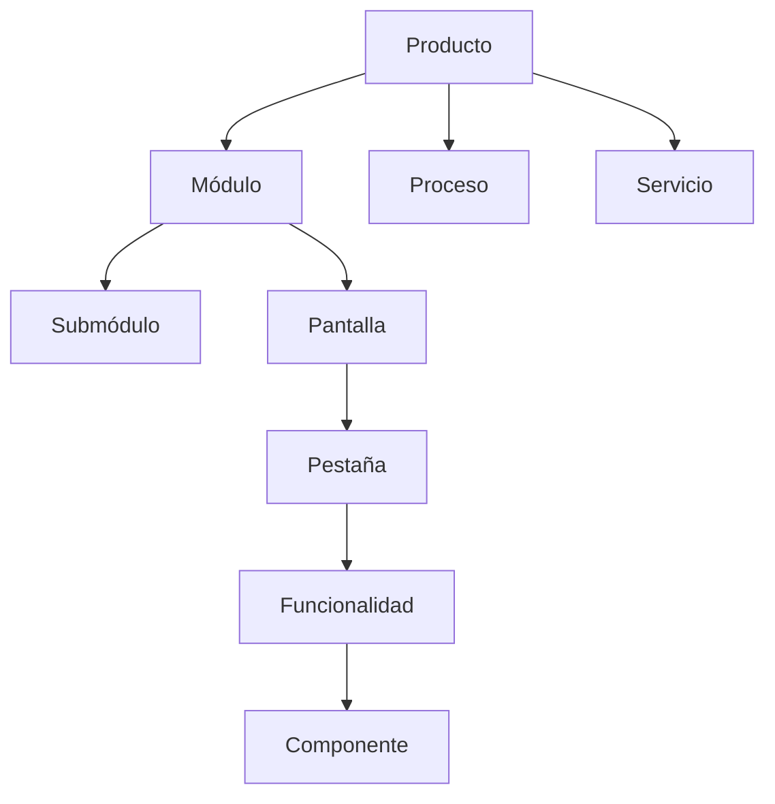
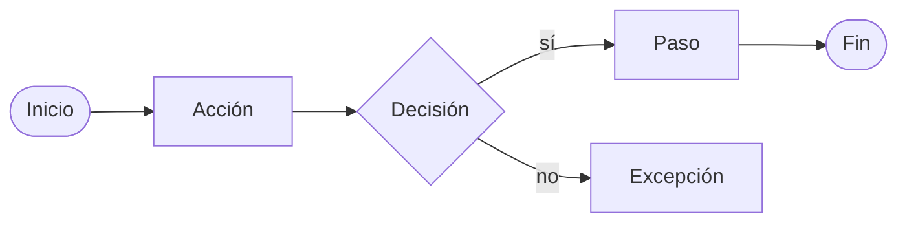

# 03 · Modelo funcional y documental objetivo

## 1. Jerarquía funcional (reutilizar lo existente)



- Implementado con `product_nodes` + `ltree` + `node_types` (8 tipos: modulo, submodulo, pantalla, pestana, componente, proceso, servicio, otro).
- `node.code` es identificador estable legible; `id` UUID interno.
- `status`: planned/in_progress/done/deprecated/disabled.
- Campos funcionales existentes: `description` (resumen) y `objective` (funcionalidad) (mig. 0008).
- **No duplicar** jerarquía en `relations`; la jerarquía es estructural, no semántica.

Funcionalidades sin representación visual se modelan como nodos tipo `proceso`/`servicio`/`componente` o como documentos globales (`scope=global`).

## 2. Catálogo documental objetivo

Tipos existentes (13) ya cubren la mayoría. Se clasifican según utilidad real:

### Primera versión (ya implementados y útiles)
- `use_case` (metadata tipada)
- `business_rule` (metadata tipada)
- `req_non_functional` (metadata tipada)
- `workflow` (metadata tipada)
- `spec`, `screen_desc`, `req_functional`, `data_model`, `api_contract`, `tech_spec`, `adr`, `tech_manual`, `test_doc`

### Tipos nuevos recomendados (fase posterior, solo si hay necesidad demostrada)
- `acceptance_criteria` (puede vivir como checklist en `tasks.acceptance_criteria` o docs `test_doc`)
- `security_requirement` (subconjunto de `req_non_functional` con category=security)
- `permission_rule` (puede ser metadata de `screen_desc` o doc `spec`)
- `validation_rule` (puede ser metadata de `workflow`)
- `ui_behavior` (puede ser `screen_desc`)
- `integration` (puede ser `api_contract` + `tech_spec`)
- `operational_process`, `scheduled_job`, `error_handling` (pueden ser `workflow`/`tech_spec`)

**Recomendación**: no agregar nuevos tipos documentales hasta que exista UI/consulta que los requiera; reutilizar los 13 actuales con metadata ampliada.

## 3. Estructura de casos de uso

Almacenado como `content_items` con `docTypeKey='use_case'` y metadata validada por `useCaseMetadataSchema`:

```json
{
  "actor": "string",
  "goal": "string",
  "preconditions": ["string"],
  "mainFlow": ["string"],
  "alternativeFlows": ["string"],
  "postconditions": ["string"],
  "priority": "critical|high|medium|low"
}
```

- Código: `documentCodeSchema` (ej. `CU-014`).
- Nombre: `title`.
- Objetivo: `goal` (metadata) + `bodyMarkdown` para detalle.
- Actores: `actor`.
- Pre/postcondiciones: arrays.
- Escenario principal/alternativos/excepciones: `mainFlow`, `alternativeFlows`, bodyMarkdown.
- Criterios de aceptación: `bodyMarkdown` o `test_doc` vinculado.
- Estado: `content_items.status`.
- Versión: `content_items.version` + `item_versions`.

**Regla de no duplicación**: `bodyMarkdown` contiene narrativa; metadata contiene campos consultables. No repetir el mismo texto en ambos.

## 4. Reglas de negocio

`businessRuleMetadataSchema`:
```json
{
  "condition": "string",
  "action": "string",
  "scope": "string",
  "exceptions": ["string"],
  "owner": "string"
}
```
- Relación con varios módulos vía `item_node_links` (N:M) y `relations` (`applies_rule`).
- Vigencia: `content_items.status` (archived = no vigente) + versión.

## 5. Requisitos funcionales

Actualmente solo Markdown. **Recomendación**: extender `FUNCTIONAL_DOCUMENT_METADATA_SCHEMAS` con `req_functional`:

```json
{
  "rationale": "string",
  "expectedBehavior": "string",
  "acceptanceCriteria": ["string"],
  "priority": "critical|high|medium|low",
  "status": "draft|approved|implemented|verified"
}
```

- No convertir cada requisito en tarea; vincular con `relations` (`specifies`, `implements`, `verifies`).
- Pruebas que verifican: `test_cases` + `relations` test_case→item (`verifies`).

## 6. Flujos funcionales (prioridad alta)

Actual: `flowMetadataSchema` con `trigger`, `steps[] {order, action, actor, system}`, `exceptions`.

**Evaluación de normalización**:
- Opción A (actual): metadata JSONB. Suficiente para documentación y consultas simples (GIN).
- Opción B: tablas `workflow_steps`, `workflow_transitions`, `workflow_step_links`.

**Decisión recomendada**: mantener JSONB en v1 (ADR-008), pero ampliar el schema con:
- `decisions[]` (condición → rama).
- `subprocesses[]` (referencias a otros documentos/nodos).
- `transitions[]` (fromStep, toStep, condition).
- `startStep`, `endSteps[]`.

Justificación: las consultas necesarias son "qué pantallas/reglas/participan en este flujo", resolubles recorriendo `item_node_links` y `relations` desde el documento flujo; no se requiere consultar pasos individuales como entidades independientes en v1. Tablas normalizadas solo si aparece necesidad de versionado por paso o de ejecución de workflows (fuera de alcance: no BPM).

Diagrama de flujo documentado:



## 7. Versionado

- Documentos aprobados: `published` + snapshot en `item_versions` (inmutable, append-only).
- Flujos: versionado incluido por snapshot de metadata.
- Casos de uso: idem.
- Relaciones: trazabilidad vía `activity_log` + `created_by`/`created_at`; si se requiere inmutabilidad, agregar `relation_versions` solo en fase posterior (no ahora).
- Análisis de impacto: tabla inmutable (ver 05).
- Pruebas: `test_results` append-only por trigger.

## 8. Identificadores

- Internos: UUID.
- Legibles: códigos por producto (`PANT-02`, `CU-014`, `RN-014`, `RF-014`, `FL-014`, `MOD-031`, `TC-014`).
- Códigos inmutables tras creación (convención; en nodos ya inmutable por servicio).

## 9. Convenciones de metadata

- JSONB con schema Zod compartido en `packages/shared`.
- GIN index para consultas por campo.
- No duplicar datos que ya están en columnas (`title`, `status`, etc.).
- Validación en create/update/version.
