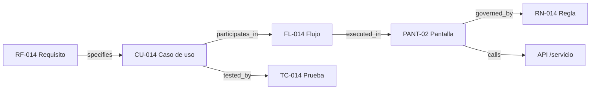

# 04 · Modelo de relaciones semánticas (grafo)

## 1. Objetivo

Convertir `relations` en el grafo semántico de DevCycle sin reescribirlo: ampliar tipos, integridad, dirección y capacidades de consulta, manteniendo PostgreSQL como fuente de verdad.

## 2. Tipos de relación

### Existentes (mantener)
`affects, documents, specifies, implements, resolves, blocks, is_blocked_by, verifies, depends_on, relates_to, modifies, references, applies_rule`

### Nuevos recomendados (agregar en fase 2, solo los necesarios)
| Tipo | Significado | Dirección típica |
|---|---|---|
| `contains` | Contención estructural explícita (solo cuando no es parent_id) | módulo→pantalla |
| `uses` | Usa otro elemento | funcionalidad→API/entidad |
| `triggers` | Dispara evento/proceso | acción→proceso |
| `validates` | Valida condición/regla | validación→regla |
| `governed_by` | Sujeto a regla | funcionalidad→regla |
| `executed_in` | Se ejecuta en pantalla/pestaña | proceso→pantalla |
| `participates_in` | Participa en flujo | elemento→flujo |
| `calls` | Llama API/servicio | pantalla→servicio |
| `reads` / `writes` | Acceso a datos | funcionalidad→entidad |
| `tested_by` | Verificado por prueba | elemento→test_case (inverso de verifies) |
| `supersedes` | Reemplaza versión/documento | doc v2→doc v1 |
| `realizes` | Realiza requisito | funcionalidad→requisito |

**No agregar todos de golpe**: empezar con `contains (si aplica), uses, governed_by, participates_in, calls, reads, writes, tested_by, supersedes, realizes` en la primera iteración; el resto según necesidad.

## 3. Reglas de dirección

- La dirección es semántica y explícita; no se asume simetría.
- Inversos se crean solo cuando aportan valor de consulta (ej. `tested_by` además de `verifies`).
- Jerarquía estructural (`parent_id`/`ltree`) no se replica en `relations`.

## 4. Integridad

Actual: CHECK kinds/types + unique. Propuesto (incremental):
1. Triggers `BEFORE INSERT/UPDATE` en `relations` que verifiquen existencia del origen/destino en la tabla correspondiente y mismo `product_id`.
2. FK compuesta por producto donde sea posible (ya existe `product_nodes_id_product_uq`).
3. Prevención de auto-relaciones (`source_id <> target_id` o kinds distintos).
4. Prevención de duplicados ya implementada.
5. Ciclos: no bloquear en BD (costoso); controlar en consultas (visited set) y optionally en aplicación.

## 5. Historial

- Creación/eliminación registrada en `activity_log` (ya).
- Si se requiere inmutabilidad de relaciones, agregar `relation_audit` o columnas `deleted_at`/`valid_from`/`valid_to` en fase posterior.
- Recomendación v1: soft delete (`deleted_at`) en `relations` para conservar historial, manteniendo unique parcial por activas.

## 6. Consultas transitivas

- Mantener BFS en aplicación para v1 (profundidad ≤ 3, ya implementado).
- Agregar CTE recursivo en PostgreSQL para consultas de impacto profundas (fase 2) con:
  - `depth` parametrizable (máx 3 por defecto, configurable).
  - `visited` para evitar ciclos.
  - filtro por tipos de relación permitidos.
- No incorporar base de datos de grafos externa.

## 7. Relación entre `item_node_links` y `relations`

| Estructura | Responsabilidad |
|---|---|
| `item_node_links` | Vínculo documento↔nodo (N:M) para navegación y FTS por nodo. Fuente de verdad de "este documento aplica a este nodo". |
| `relations` | Relaciones semánticas tipadas entre cualquier entidad (incluye item↔node si es semántica, ej. `documents`). |

Regla: no duplicar `item_node_links` como `relations` automáticamente; crear relación `documents` solo cuando se necesite semántica explícita (ej. "este documento especifica esta pantalla").

## 8. Ejemplo de trazabilidad

## 9. Prevención de grafos ilegibles

- Visualizaciones filtradas por contexto (nodo seleccionado + tipos de relación).
- No mostrar grafo completo por defecto.
- Límite de profundidad y número de nodos en UI.
