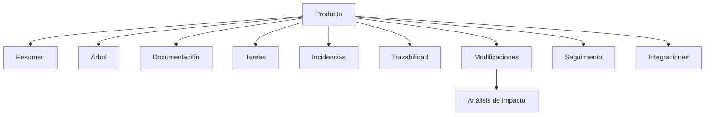

# 06 · Diseño de interfaz

## 1. Principios

- Interfaz compacta, funcional, orientada a trabajo técnico.
- Reutilizar vistas y componentes existentes.
- No añadir landings comerciales, suscripciones, facturación, marketing.
- Visualizaciones filtradas por contexto; no grafos completos por defecto.

## 2. Navegación existente (reutilizar)

Sidebar por producto (`app-shell.tsx`): Resumen, Árbol, Documentación, Tareas, Incidencias, Trazabilidad, Modificaciones, Seguimiento, Integraciones.

## 3. Vistas objetivo

### 3.1 Explorador funcional (Árbol)
Ya existe `arbol/page.tsx` + `tree-view.tsx`. Mejoras:
- Mostrar contexto del elemento seleccionado (descripción/objetivo) (ya).
- Añadir pestaña "Impacto" en ficha.
- Añadir "Flujos relacionados".

### 3.2 Explorador documental
Ya existe `documentacion/page.tsx` + `docs-view.tsx`. Mejoras:
- Filtros por tipo (ya), estado, nodo, huérfanos.
- Añadir filtro "sin nodo asociado".
- Indicador de docs desactualizadas.

### 3.3 Explorador de flujos
Nuevo: puede ser una vista filtrada en Documentación (tipo `workflow`) + editor de metadata. No crear rediseño completo. Reutilizar `docs-view` con panel lateral de pasos.

### 3.4 Mapa de relaciones
Ya existe `trazabilidad/page.tsx` + `trazabilidad-view.tsx` (grafo BFS). Mejoras:
- Filtros por tipo de relación y profundidad (ya parcial).
- Vista "dependientes" para impacto.
- Límite de nodos.

### 3.5 Análisis de cambios
Ya existe `modificaciones/page.tsx`. Mejoras:
- Botón "Analizar impacto" que crea `change_impact_assessments`.
- Mostrar impacto directo/transitivo/potencial, pruebas, docs.

## 4. Componentes reutilizables

`tree-view`, `docs-view`, `markdown-editor`, `tasks-view`, `issues-view`, `trazabilidad-view`, `modificaciones-view`, `seguimiento-view`, `integraciones-view`, `app-shell`.

## 5. Nuevas vistas mínimas

- `impacto` (o pestaña en modificaciones): visualización de análisis.
- `flujos` opcional: puede integrarse en documentación.

## 6. Diagrama de navegación

## 7. No hacer

- No rediseñar toda la interfaz.
- No agregar dashboards saturados (seguimiento ya prioriza tablas/listas).
- No agregar vistas comerciales.
