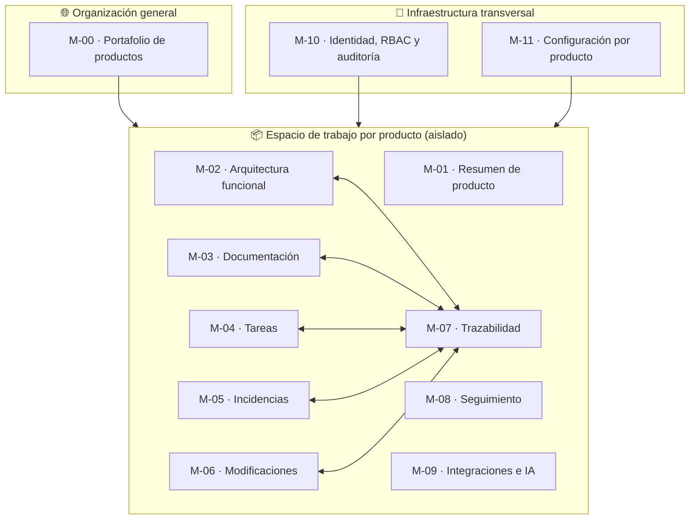

# 02 · Arquitectura funcional

La plataforma tiene **9 módulos de dominio** (los del prompt §5) + 2 de infraestructura. Esta arquitectura funcional describe **qué hace la plataforma**; el diseño técnico está en [03-arquitectura-tecnica.md](03-arquitectura-tecnica.md) y el modelo de datos en [04-modelo-datos.md](04-modelo-datos.md). La navegación y las pantallas están detalladas en [05-experiencia-usuario.md](05-experiencia-usuario.md).

## 1. Visión general



**Regla estructural central (§4 del prompt):** el producto es el centro del conocimiento. `M-02` aloja la jerarquía; `M-03` a `M-06` producen elementos; `M-07` los relaciona; `M-08` los resume. `M-09` abre la puerta a agentes sin duplicar lógica: consume la API central.

## 2. Módulos, funcionalidades y responsabilidades

### M-00 · Portafolio de productos (organización general) — §5.1

**Responsabilidad:** alta, estado y consulta transversal de todos los productos. No contiene datos de dominio de ningún producto; solo métricas agregadas.

| Funcionalidad | Operaciones | Pantallas (vistas del mockup) |
|---|---|---|
| Listado de productos | Tabla: estado, avance, módulos, tareas abiertas, incidencias, actividad, navegación al espacio | `Productos` |
| Alta de producto | Crear producto (nombre, tagline, descripción, objetivos, stack), bootstrap de tipos de nodo y estados por defecto | Modal desde `Productos` |
| Métricas de organización | KPIs agregados calculados por producto (avance medio, incidencias abiertas, cobertura documental) | Franja superior de `Productos` |
| Aislamiento | Selector de contexto; en modo organización las vistas de producto están deshabilitadas | Sidebar |

**API:** `GET /products`, `POST /products`, `GET /products/:id/metrics` · **Entidades:** products, product_members · **Roles:** Administrador global crea; Consulta lee.

### M-01 · Resumen de producto — §5.1

**Responsabilidad:** ficha integral del producto: descripción, objetivos, estado, tecnología, integrantes, actividad general, documentación global.

| Funcionalidad | Pantalla |
|---|---|
| Descripción y objetivos (con progreso) | `Resumen` (columna izquierda) |
| Información tecnológica: stack, repositorio, entornos | `Resumen` |
| Integrantes con roles (lectura; edición → `M-11`) | `Resumen` |
| Actividad reciente (timeline, distingue humano/agente) | `Resumen` |
| Documentación global del producto | `Resumen` → `Documentación` filtrada por `scope=global` |
| Avance por módulo (top insights jerárquicos) | `Resumen` |

**API:** `GET /products/:id`, `GET /products/:id/activity`, `GET /products/:id/metrics` · **Entidades:** products, product_members, activity_log.

### M-02 · Arquitectura funcional — §5.2

**Responsabilidad:** construir y mantener el árbol funcional configurable de cada producto; alojar elementos y su evolución. **Nunca** convierte tareas en nodos ni nodos en tareas.

| Funcionalidad | Notas de diseño |
|---|---|
| CRUD de nodos y tipos de nodo (incl. tipo configurable) | Tipos precargados: Módulo, Submódulo, Pantalla, Pestaña, Componente, Proceso, Servicio + personalizados (nombre, color, icono) |
| Jerarquía: mover nodo (cambiar padre), reorganizar posición, duplicar estructura | Move re-calcula `path ltree`; duplicado copia subárbol con códigos nuevos |
| Desactivar nodo (soft-delete; jamás borrado físico si tiene historia) | `deleted_at`; las relaciones se conservan |
| Consulta de historial y relaciones por nodo | Alimenta pestañas `Relaciones` e `Historial` de la ficha |
| Ficha integral del elemento con pestañas | Resumen · Funcionalidad · Documentación · Tareas · Incidencias · Relaciones · Historial (contadores en vivo) |
| Validación de movimiento | Prohibir ciclos (un nodo no puede ser hijo de su descendiente) |
| Filtro por tipo de nodo y búsqueda dentro del árbol | En mockup implementado; el backend valida también |

**Pantallas:** `Arquitectura funcional` (split árbol + ficha) · **API:** `GET/POST/PATCH /nodes`, `POST /nodes/:id/move|duplicate|deactivate`, `GET /nodes/:id/history|relations` · **Entidades:** product_nodes, node_types, relations, activity_log.

### M-03 · Documentación — §5.3

**Responsabilidad:** documentación como ciudadano de primer orden del árbol: tipada, versionada, relacionada y buscable.

| Funcionalidad | Notas |
|---|---|
| 13 tipos documentales + tipo `adr` (decisión arquitectónica) | Catálogo en `document_types`, ampliable |
| Documentos multi-nodo: asociar documento a N nodos; N documentos por nodo | Tabla puente `item_node_links` |
| Relación documento↔documento (regla → caso de uso → especificación) | Tabla `relations` (kind=item) |
| Versionado inmutable: numeración por documento, diff, autor, fecha, mensaje | `item_versions` |
| Editor Markdown con vista previa | CodeMirror 6 + remark/rehype; guardado con debounce y "publicar versión" explícito |
| Adjuntos y diagramas | Storage S3-compatible; validación de MIME y tamaño |
| Estados: borrador → en revisión → vigente | Transición controlada; publicación solo `Administrador de producto` o autor con permiso |

**Pantallas:** `Documentación` (lista filtrable + vista previa + historial de versiones) · pestaña Documentación en la ficha de elemento · **API:** `GET/POST/PATCH /documents`, `POST /documents/:id/versions`, `GET /documents/:id/versions/:n`, adjuntos `POST /attachments` · **Entidades:** content_items, document_types, item_versions, item_node_links, attachments, comments.

### M-04 · Tareas — §5.4 + §6

**Responsabilidad:** trabajo planificado vinculado a la arquitectura funcional. Vista independiente del árbol, sincronizada mediante `relations`.

| Funcionalidad | Notas |
|---|---|
| CRUD de tareas + tipos (Desarrollo, Análisis, Documentación, Mantenimiento) | `tasks.type`; ampliable por producto |
| Campos completos: título, descripción, estado, prioridad, responsable, fechas, estimación, criterios de aceptación | Criterios como checklist estructurada (`jsonb`) |
| Dependencias entre tareas (`bloquea` / `es_bloqueada_por`) | `relations` kind=task + validación de aciclicidad |
| N tareas ↔ N nodos; N tareas ↔ N documentos | `relations` kind mixto |
| Estados configurables por producto + transiciones controladas + `Bloqueada` transversal | `workflow_states` + `state_transitions` |
| Comentarios e historial | `comments` + `activity_log` |
| Vista global: Árbol (agrupada por nodo) / Tabla / Kanban | Un solo dataset, tres representaciones; kanban con columnas por estado |
| Filtros combinables: tipo, estado, prioridad, responsable, texto, nodo | En mockup: implementados cliente-lado; backend: misma semántica |

**Pantallas:** `Tareas` · pestaña Tareas en ficha · **API:** `GET/POST/PATCH /tasks`, `POST /tasks/:id/status`, `POST /tasks/:id/dependencies`, `GET /tasks?groupBy=node&view=tree|table|kanban` · **Entidades:** tasks, workflow_states, state_transitions, comments, relations, activity_log.

### M-05 · Incidencias — §5.5

**Responsabilidad:** errores y problemas funcionales, reproducibles y vinculados a elementos, tareas y cambios correctivos.

| Funcionalidad | Notas |
|---|---|
| Registro con comportamiento esperado/observado, pasos, severidad, prioridad, estado, responsable | Maestro–detalle en UI |
| Evidencias como adjuntos | `attachments` owner_kind=issue |
| Vínculos: elemento afectado (N), tareas (N), modificaciones correctivas (N) | `relations` |
| Transiciones controladas (Abierta → En análisis → En corrección → En verificación → Verificada) | Reutiliza motor de flujos de M-04 con `scope=issue` |
| Detección de regresión: incidencia verificada reabierta | Contador `reopen_count`; alerta en seguimiento |

**Pantallas:** `Incidencias` (maestro-detalle) · pestaña Incidencias en ficha · **API:** `GET/POST/PATCH /issues`, `POST /issues/:id/resolve`, `GET /issues/:id/relations` · **Entidades:** issues, attachments, comments, relations.

### M-06 · Modificaciones — §5.6

**Responsabilidad:** registro oficial de cambios del producto; fuente de verdad funcional (Git es fuente auxiliar, no sustituto).

| Funcionalidad | Notas |
|---|---|
| Change propuesta vs ejecutada con fecha, autor, tipo (funcional/técnica) | `changes.status` |
| Vínculos: elementos afectados (N), tareas (N), incidencias que resuelve (N), documentos modificados (N), decisiones (N) | `relations` mixto |
| Referencias Git: repo, rama, commit SHA, PR, ficheros tocados | `changes.git_*`; importables por webhook (Fase 6) |
| Historia de evolución consultable por pantalla | Endpoint `GET /nodes/:id/changes` |

**Pantallas:** `Modificaciones` (tabla filtrable) · bloque en pestaña Historial de ficha · **API:** `GET/POST/PATCH /changes`, `POST /changes/:id/link`, `GET /nodes/:id/changes` · **Entidades:** changes, relations, activity_log, integrations (git).

### M-07 · Trazabilidad — §5.7

**Responsabilidad:** motor genérico de relaciones y consultas inversas. Sin M-07 no existe la promesa central del producto; es el módulo más crítico arquitectónicamente.

| Funcionalidad | Notas |
|---|---|
| CRUD de relaciones tipadas entre elementos heterogéneos | `relations(source_kind, source_id, target_kind, target_id, relation_type, metadata)` |
| Integridad referencial garantizada (triggers de existencia por `kind`) | Ver [04](04-modelo-datos.md) §7 y [08](08-estrategia-pruebas.md) §6 |
| Relaciones salientes/entrantes desde la ficha de cualquier elemento | Endpoint `GET /relations?entity=kind:id&direction=out|in` |
| Las 7 consultas canónicas como endpoints dedicados + una vista combinada | `GET /trace/tasks-affecting-node/:id`… ver [04](04-modelo-datos.md) §9 |
| Detección de ciclos en dependencias (tareas y nodos) | DFS acotado en escritura |
| Grafo visual por elemento (SVG/Canvas) | En mockup: SVG estático de referencia; producción: capa cliente sobre API |
| Consulta transitiva acotada (profundidad ≤ 3) para "impacto" | Buffer anti-explosión |
| Limpieza/auditoría de huérfanos | Job semanal + endpoint admin |

**Pantallas:** `Trazabilidad` (consultas + grafo) · pestaña Relaciones en cada ficha · **API:** `GET/POST/DELETE /relations`, `GET /trace/*` · **Entidades:** relations, activity_log, vistas SQL.

### M-08 · Seguimiento — §5.8

**Responsabilidad:** estado del desarrollo en listas y tablas jerárquicas; nada de dashboards ornamentales.

| Funcionalidad | Notas |
|---|---|
| Actividad reciente (todas las acciones, humano/agente) | Timeline unificada desde `activity_log` |
| Tareas pendientes / bloqueadas / en curso | Tablas con enlaces a la ficha |
| Incidencias abiertas por severidad | Tabla |
| Avance por módulo/producto | Barras calculadas: completado ponderado por estimación o conteo simple (elegir uno; propuesto: conteo simple en v1) |
| Elementos sin documentación / sin pruebas | Detección por ausencia de `relations` salientes a docs/test_cases |
| Modificaciones recientes | Tabla |
| Búsqueda global | Full-text español + códigos (`PANT-02`); índices GIN |

**Pantallas:** `Seguimiento` · **API:** `GET /products/:id/overview`, `GET /search`, `GET /products/:id/coverage` · **Entidades:** vistas de solo lectura sobre activity_log, tasks, issues, relations, content_items, test_cases.

### M-09 · Integraciones e IA (capa de agentes) — §5.9 + MCP §1–§8

**Responsabilidad:** interfaz independiente entre la plataforma y agentes externos; Claude Code como cliente principal; nunca acoplada a un proveedor. **No** contiene lógica de dominio: toda su lógica delega en la API central.

| Funcionalidad | Notas |
|---|---|
| API REST pública (OpenAPI 3.1) con scopes | Base de todas las integraciones; también consumida por MCP |
| Servidor MCP independiente (`apps/mcp-server`): 32 herramientas, recursos con URIs estables, 7 prompts | Detalle completo en [06](06-integraciones-agentes.md) |
| Service tokens por producto con hash y revocación | `service_accounts` + `api_tokens` |
| Auditoría de agent_executions (entrada, resultado, actor, duración) | `agent_executions` |
| Ingesta Git por webhook: commits/PR ↔ MOD ↔ nodos | Cola de procesamiento idempotente; sin escritura directa fuera de relations/changes |
| Export Markdown bajo demanda | Job en API; entrega .zip o push a repo (opt-in) |
| Diferenciación humano/agente en toda la UI | Badge `AGENTE IA` en timelines, historial y auditoría |

**Pantallas:** `Agentes IA` · `Configuración → Integraciones` (toggles) · **API:** endpoints `scope=integration` · **Entidades:** integrations, service_accounts, api_tokens, agent_executions.

### M-10 · Identidad, RBAC y auditoría — §9

**Responsabilidad:** autenticación, autorización por producto, auditoría transversal. Base de toda la seguridad; todo módulo depende de él.

| Funcionalidad | Notas |
|---|---|
| Login email+contraseña (better-auth, sesiones en DB) | HttpOnly, SameSite=Lax, rotación de sesión |
| Roles: Administrador global / de producto / Colaborador / Consulta | Matriz de permisos en [05](05-experiencia-usuario.md) §8 y [04](04-modelo-datos.md) §10 |
| Permisos granulares documentación (leer, editar, publicar, gestionar versiones) | `permissions` + `role_permissions` |
| Aislamiento por producto en cada consulta (guard + `product_id`) | Pruebas de tenant-escape obligatorias |
| Auditoría append-only | `activity_log` inmutable; ni siquiera admin global puede editar/borrar |
| Gestión de sesiones/token: revocar, listar | UI en `Configuración` |

**Pantallas:** flujo de login; `Configuración → Miembros y roles` · **Entidades:** users, sessions, roles, permissions, role_permissions, product_members, activity_log.

### M-11 · Configuración por producto — §5, §9

**Responsabilidad:** parámetros de cada espacio de trabajo sin tocar código.

| Funcionalidad | Notas |
|---|---|
| Miembros e invitaciones por producto | Invitación con token de un solo uso |
| Tipos de nodo personalizados (nombre, color, icono, si es estructural) | `node_types` scope=product |
| Estados y transiciones de tareas e incidencias | `workflow_states`, `state_transitions` scope+entity |
| Integraciones por producto (MCP, Git, webhooks salientes, export) | `integrations` |
| Roles personalizables? No en v1: solo los 4 roles fijos + asignación por producto | Evita explosión de permisos |

**Pantallas:** `Configuración` con 4 pestañas (Miembros y roles · Tipos de nodo · Estados de tarea · Integraciones).

## 3. Jerarquías de navegación (resumen; detalle en [05](05-experiencia-usuario.md))

```
Organización general
└── Productos
    └── [Producto]  ← espacio de trabajo aislado
        ├── Resumen
        ├── Arquitectura funcional   ← árbol + ficha integral (tabs)
        ├── Documentación
        ├── Tareas                    ← árbol funcional / tabla / kanban
        ├── Incidencias
        ├── Modificaciones
        ├── Trazabilidad              ← grafo + 7 consultas canónicas
        ├── Seguimiento
        ├── Agentes IA
        └── Configuración             ← miembros, tipos de nodo, estados, integraciones
```

## 4. Responsabilidades y límites entre módulos

| Módulo | Puede escribir en | Lee de | Nunca toca |
|---|---|---|---|
| M-00 Portafolio | products, product_members | activity_log (métricas) | Nodos, docs, tareas |
| M-02 Árbol | product_nodes, node_types | relations (vía API) | Tareas/incidencias directamente |
| M-03 Documentación | content_items, item_versions, item_node_links, attachments | product_nodes (valida existencia) | Tareas |
| M-04 Tareas | tasks, workflow_states, comments | product_nodes (vía relations) | Contenido documental |
| M-05 Incidencias | issues, attachments | product_nodes vía relations | Changes |
| M-06 Modificaciones | changes | — | — |
| M-07 Trazabilidad | relations | todo (solo lectura) | Datos de dominio |
| M-08 Seguimiento | — (solo lectura) | todo (vistas SQL) | — |
| M-09 Integraciones | integrations, api_tokens, agent_executions | API central | PostgreSQL directo ❌ |
| M-10 Identidad | users, sessions, roles, product_members | — | Datos de dominio |
| M-11 Configuración | workflow_states, state_transitions, node_types, integrations | users | — |

**Prohibido:** cualquier módulo de dominio escribe directamente en entidades de otro módulo; la coordinación entre módulos pasa por servicios de aplicación dentro del monolito (transacciones) o por `relations`/`activity_log`. Los módulos compartidos (M-07, M-10) exponen APIs internas estables, no tablas.
