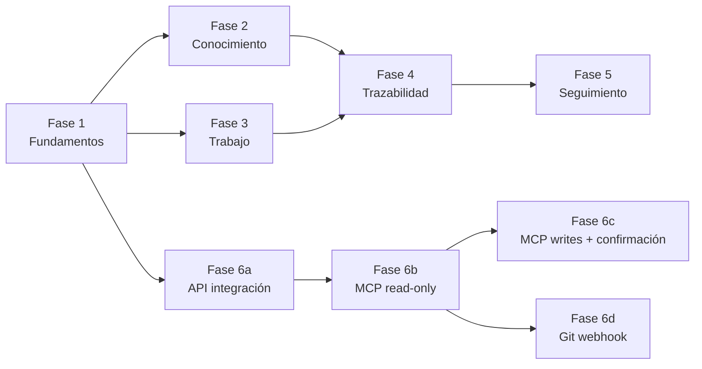

# 07 · Plan de implementación

> Metodología §12 del prompt ejecutada. Cada fase define: objetivo, alcance, dependencias, funcionalidades, entidades, pantallas, API, pruebas, criterios de aceptación, riesgos, entregables descompuestos y tareas verificables (`F#-T##` · tamaño S/M/L · dependencias entre tareas). IDs de pruebas en [08](08-estrategia-pruebas.md); IDs de épicas en [10](10-backlog-inicial.md).

## 0. Reglas de planificación

1. Ninguna fase entrega "todo" su módulo a medias: **el corte vertical mínimo** primera navegación→dato→pantalla→test.
2. Toda fase deja la `main` desplegable (CI verde, migraciones reversibles).
3. Alcance de agentes: **Fase 6 se subdivide** en 6a (API de integración + scopes), 6b (MCP read-only — reemplaza la antigua "Fase 6 genérica"), 6c (MCP escrituras + confirmación), 6d (Git webhook). Justificación: la sección MCP del prompt lo exige así y reduce el riesgo del punto crítico (R-02).
4. Estimaciones relativas (S ≈ 0.5–1 día, M ≈ 2–4 días, L ≈ 1–2 semanas, XL ≈ spike/POC) para equipo de 1–2 devs part-time; se recalibran tras Fase 1.
5. Prioridades: **P0** bloqueante para la siguiente fase · **P1** necesario para cerrar la fase · **P2** puede diferirse.

## 1. Dependencia entre fases

Cambio respecto a la secuencia inicial del prompt: se adelanta **6a (API de integración con scopes y service tokens) como dependencia de Fase 3/4**, porque `register_change` y los tokens de servicio se necesitan allí; solo se desplazaría si el equipo valida la Fase 1 sin agentes (recomendado: implantar 6a justo al terminar Fase 3, en paralelo a Fase 4). Fase 4 sigue dependiendo de F2+F3 (modificaciones y relaciones ya existen).

## 2. Fase 1 · Fundamentos

**Objetivo:** cimientos verificables: monorepo, CI, autenticación, organización/productos e árbol mínimo funcional. **Sin lógica de dominio**.
**Alcance:** estructura repo; git init; TS strict; lint+format; Postgres + Drizzle + migraciones; auth (sesiones DB); entidades org/product/member/node_type/product_node; árbol con move/duplicate/deactivate; guards RBAC base; activity_log mínimo; design system base (`packages/ui` ligero); pantalla Productos + espacios + navegación del mockup portada.
**Dependencias:** ninguna.
**Entidades afectadas:** organizations, products, product_members, users, roles, permissions, role_permissions, sessions(better-auth), node_types, product_nodes, activity_log, workflow_states (catálogo seed), document_types (seed).
**Pantallas (mockup):** login (nueva, fuera del mockup pero obvia), Productos, Resumen (esqueleto), Arquitectura funcional (árbol + ficha con tabs vacías), Configuración → Miembros y Tipos de nodo (básico).
**API:** `/api/v1/health`, auth (`sign-in/up/out`), `/products*`, `/nodes*` (CRUD + move/duplicate/deactivate), `/me`.
**Pruebas:** FND-U (unit TreeService: ciclos, orden, ltree), FND-I (API productos/nodos contra PG efímero), FND-E2E (Playwright: login→crear producto→crear módulo→pantalla visible), FND-SEC (guards niegan sin sesión; tenant-escape v1: nodo de A inaccesible desde B), FND-MIG (up/down de la migración 001).

**Entregables y tareas verificables:**

| ID | Tarea | Tam | Dep | Prioridad | Criterio de aceptación |
|---|---|---|---|---|---|
| F1-T01 | `git init`, `.gitignore`, estructura pnpm+Turborepo, Node 22, TS strict, ESLint+Prettier | M | — | P0 | `pnpm build && pnpm lint && pnpm typecheck` verde en CI vacío |
| F1-T02 | `packages/db`: Drizzle + PG16 + `migrate` + migración 001 (org, users, roles, permissions, products, product_members, node_types, product_nodes ltree, activity_log) | L | T01 | P0 | Migración up/down reversible; seed idempotente (`seed:run`) |
| F1-T03 | `packages/shared`: zod base, errores RFC 9457, tipos de dominio (NodeCode branded, Result) | M | T01 | P0 | Tipos consumibles por web y api sin ciclos |
| F1-T04 | `apps/api`: bootstrap NestJS, health, config (`@nestjs/config` + validación env), logger pino, módulo `iam` (better-auth email+contraseña, sesiones en PG, cookies) | L | T02,T03 | P0 | Login/logout funcional; sesión revocable; cookie HttpOnly |
| F1-T05 | RBAC: roles fijos seed (admin_global, admin_product, collaborator, viewer), permisos granulares, `@Permissions()` guard, `productGuard` (product_id) | M | T04 | P0 | 403 sistemático sin permiso; org-admin bypass documentado |
| F1-T06 | `products` CRUD + creación compuesta (seed de tipos de nodo, estados, MCP integration disabled) + invitación de miembros | M | T05 | P0 | Crear producto devuelve espacio listo; 2 productos no se cruzan |
| F1-T07 | `product_nodes`: CRUD, `move` (transaction + validación ciclo + recompute ltree), `duplicate` (subárbol, nuevos códigos), `deactivate` (soft-delete) | L | T06 | P0 | Move entre ramas conserva hijos; código duplicado rechazado con 409 |
| F1-T08 | `apps/web`: Next.js App Router + layout (sidebar+topbar del mockup), login, selector de contexto, Productos, Resumen skeleton, árbol funcional (read-only) + ficha vacía | XL | T07 | P0 | Navegación completa keyboard-accessible; Ctrl+K navega a vistas |
| F1-T09 | `packages/ui`: Tree, DataTable, Pill, Tabs, EmptyState, CommandPalette (portados de `muckup/`, con tests de componente) | L | T08 | P1 | Storybook ligero opcional; componentes cubiertos ≥70% |
| F1-T10 | CI GitHub Actions: lint, typecheck, unit, integration (PG service), e2e (Playwright chromium), build imágenes | M | T02 | P0 | Badge verde; deploy previo a staging manual |
| F1-T11 | ADR-001..005 (monorepo, NestJS, Drizzle, better-auth, ltree) en `docs/adr/` | M | — | P1 | ADRs enlazan alternativas (sección "Alternativas") |
| F1-T12 | Seed demo: 3 productos ficticios (versión reducida del mockup) + script `pnpm demo` | S | T06,T07 | P1 | Clonar → `pnpm demo` → app usable en 5 min |

**Criterios de aceptación de fase:** login real; crear 2 productos aislados; árbol operativo (move/duplicate/deactivate con ltree íntegro — probado por fuzz de 1.000 movimientos aleatorios); CI verde; demo seeds; cero deuda de tipado (`strict` limpio); time-to-interactive < 1.5 s en Productos.
**Riesgos:** R-03 (alcance), R-07 (better-auth novelidad) — ver [09](09-riesgos-y-decisiones.md).

## 3. Fase 2 · Conocimiento

**Objetivo:** documentación como ciudadano de primera: versionada, tipada, vinculada, buscable.
**Alcance:** M-03 completo + adjuntos + relaciones documento↔nodo (`item_node_links`) + relaciones doc↔doc + estados de documento + búsqueda FTS.
**Dependencias:** Fase 1 (nodos, auth, UI base).
**Entidades:** document_types, content_items, item_versions, item_node_links, attachments, relations (base), comments (base).
**Pantallas:** Documentación (lista + preview + versiones), ficha → pestaña Documentación funcional, editor (CodeMirror + preview).
**API:** `/documents*`, `/documents/:id/versions*`, `/attachments*`, `/search?kinds=document`.

| ID | Tarea | Tam | Dep | Pri | Criterio de aceptación |
|---|---|---|---|---|---|
| F2-T01 | Esquema content_items/item_versions/document_types/item_node_links + migración 002 + seed de 14 tipos (13 + adr) | M | F1 | P0 | Up/down OK; seed idempotente |
| F2-T02 | CRUD documents con estados (draft/in_review/published), transiciones controladas y publicación solo con `docs:publish` | L | T01 | P0 | Publicar sin permiso → 403; versión publicada inmutable |
| F2-T03 | Versionado: `item_versions` append-only; publish crea versión; diff de versiones (jsdiff en cliente) | M | T02 | P0 | N versiones conservadas; diff visible; UNIQUE(item,version) |
| F2-T04 | Editor CodeMirror 6 + preview remark/rehype (sanitizado con rehype-sanitize) + autosave local (debounce) | L | T02 | P1 | Preview < 100 ms; no XSS por HTML incrustado |
| F2-T05 | Adjuntos: `StoragePort` (FS en dev, S3 SDK), validación MIME+size+SVG sanitizado, `Attachment` header | M | T01 | P1 | Subida a nodo; rechazo de .svg malicioso (test) |
| F2-T06 | Vinculación doc↔nodo y doc↔doc vía `relations` (triggers activos para kinds item/node) | M | T01 | P0 | Relación a nodo inexistente → 422/400 con problem+json |
| F2-T07 | Búsqueda global v1 (FTS español + códigos) + endpoint `/search` | M | T02 | P1 | "PANT-02" y "asignación" encuentran el documento |
| F2-T08 | UI Documentación (grillas del mockup): filtros, búsqueda, diff, timeline de versiones | L | T04,T06 | P0 | Paridad funcional con mockup/vista docs |
| F2-T09 | Pruebas: versionado concurrente (409 con expectedVersion), publicación, adjuntos, tenant-escape en docs | M | T02..T06 | P0 | Suite verde en CI |

**Criterios de aceptación de fase:** publicar DOC v1→v2 y ver diff; 13 tipos operativos; doc a N nodos visible en ambos; búsqueda devuelve resultados; publicación requiere permiso; adjunto servido de forma segura.
**Riesgos:** sanitización Markdown (R-06), permisos docs granulares (R-05).

## 4. Fase 3 · Trabajo

**Objetivo:** tareas e incidencias completas y tablero vivo.
**Alcance:** M-04, M-05 + kanban + dependencias + transiciones configurables + comentarios.
**Dependencias:** Fase 1 (árbol); Fase 2 recomendable (docs en ficha de tarea) pero no bloqueante — Fase 3 puede arrancar a la vez; se define orden por capacidad.
**Entidades:** tasks, workflow_states, state_transitions, issues, comments, relations (task↔node/doc), test_cases*, (seed).
**Pantallas:** Tareas (árbol/tabla/kanban + filtros), Incidencias (maestro-detalle), ficha → pestañas Tareas/Incidencias funcionales.
**API:** `/tasks*`, `/tasks/:id/status`, `/tasks/:id/dependencies`, `/issues*`, `/issues/:id/resolve`, `/comments*`.

| ID | Tarea | Tam | Dep | Pri | Criterio |
|---|---|---|---|---|---|
| F3-T01 | Esquema tasks/issues/workflow_states/state_transitions/comments + seed estados por defecto + migración 003 | M | F1 | P0 | Transiciones default sembradas; issue scope con workflow propio |
| F3-T02 | CRUD tareas + criterios de aceptación (checklist jsonb) + estimación + due date + assignee | M | T01 | P0 | CRUD completo validado zod |
| F3-T03 | Motor de transiciones: `canTransition(scope, from, to, permissions)` puro + aplicación a tasks/issues | M | T01 | P0 | Transición no declarada → 409 con detalle |
| F3-T04 | Dependencias task↔task (`blocks`/`is_blocked_by`) con detección de ciclos y `get_dependencies` interno | M | T02 | P1 | Ciclo rechazado con error legible |
| F3-T05 | Relaciones task↔node y task↔doc (relations + triggers) + "crear tarea desde ficha" | M | T02 | P0 | N nodos por tarea; visible en pestañas de ambos |
| F3-T06 | UI Tareas: 3 vistas conmutables (tree agrupado por nodo, tabla ordenable, kanban DnD con `@dnd-kit`) + filtros URL-driven | L | T05, F1-T09 | P0 | Mismo dataset, 3 representaciones; estado en query params |
| F3-T07 | UI Incidencias maestro-detalle (esperado/observado/pasos/evidencias/vínculos) | M | T02 | P0 | Paridad con mockup |
| F3-T08 | Comentarios con menciones (`@usuario`) y timeline humana | M | T02 | P1 | Mencionar notifica (activity + badge) |
| F3-T09 | Pruebas: transiciones inválidas, kanban DnD (Playwright), permisos, dependencias cíclicas, tenant-escape | M | T02..T06 | P0 | Suite verde |

**Criterios de aceptación:** crear tarea desde ficha → aparece en kanban global; arrastrar entre columnas respeta transiciones; incidencia → tarea correctiva → vinculada; búsqueda `PANT-02` filtra tareas.
**Riesgos:** R-04 (kanban DnD fragilidad), R-03.

## 5. Fase 4 · Trazabilidad

**Objetivo:** el diferenciador: relaciones genéricas bidireccionales + modificaciones + historia por elemento.
**Alcance:** M-06, M-07 completos + historial unificado + barridos de integridad.
**Dependencias:** F2 (docs), F3 (tareas/incidencias).
**Entidades:** changes, relations (endurecida), test_cases/test_results (esquema), agent_executions (incipiente para 6a).
**Pantallas:** Modificaciones (tabla), Trazabilidad (7 consultas + grafo), ficha → Relaciones + Historial funcionales, agente (esqueleto).
**API:** `/relations*`, `/trace/*` (7), `/changes*`, `/nodes/:id/history`, `/nodes/:id/changes`.

| ID | Tarea | Tam | Dep | Pri | Criterio |
|---|---|---|---|---|---|
| F4-T01 | Esquema changes/test_cases/test_results + migración 004 | M | F2,F3 | P0 | Up/down OK |
| F4-T02 | Endurecer `relations`: triggers de existencia por kind (node/item/task/issue/change/test_case), anti-auto-relación, UNIQUE anti-dup | M | F2 | P0 | Insertar relación a elemento de otro producto → bloqueada (test) |
| F4-T03 | CRUD changes (proposed/executed) + refs Git + vínculo incidencias resueltas (`resolves`) con cierre atómico de INC | L | T01,T02 | P0 | MOD resuelve INC → ambas actualizadas en una transacción |
| F4-T04 | Servicio de historia por elemento (nodos): unión ordenada de activity_log + item_versions + changes + status changes | M | T03 | P0 | Timeline consistente humano/agente |
| F4-T05 | 7 endpoints canónicos + índices + límite de profundidad ≤3 | M | T02 | P0 | Latencia p95 < 300 ms con 100k relations (seeds sintéticos) |
| F4-T06 | UI Trazabilidad: chips de consulta + tabla resultado + grafo SVG (clickeable) + cabeceras salientes/entrantes | L | T05 | P0 | Paridad con mockup/vista trazabilidad |
| F4-T07 | Job semanal `relations-sweep` (detecta huérfanos/ciclos residuales; métrica) | S | T02 | P2 | Informe «0 huérfanos» en staging |
| F4-T08 | Pruebas property-based: generador de operaciones aleatorias sobre relations; invariante cero huérfanos tras N ops | M | T02 | P0 | 1.000 runs sin violación |

**Criterios de aceptación:** INC-087 → TAR → MOD-031 (executed) → verificada con historia completa visible por pantalla; las 7 consultas canónicas documentadas y probadas; grafo navegable.
**Riesgos:** R-01 (modelo polimórfico) — mitigado por triggers + property tests.

## 6. Fase 5 · Seguimiento

**Objetivo:** visibilidad operativa con tablas/listas; búsqueda y cobertura.
**Alcance:** M-08 + búsqueda global madura + cobertura documental/pruebas.
**Dependencias:** F2 (FTS), F3, F4 (relaciones para cobertura).
**Pantallas:** Seguimiento (actividad, avance por módulo/producto, sin doc, sin pruebas, bloqueadas, modificaciones recientes) + `/search` global (paleta usa el mismo índice).

| ID | Tarea | Tam | Dep | Pri | Criterio |
|---|---|---|---|---|---|
| F5-T01 | Vistas materializadas `product_overview` (avance por módulo/producto) + refresh incremental | M | F4 | P0 | Datos correctos tras completar 1 tarea (test e2e) |
| F5-T02 | Cobertura documental y de pruebas por nodo (ausencia de relations) | M | F4 | P0 | Listados "sin doc" / "sin pruebas" exactos (test con fixtures) |
| F5-T03 | Activity feed cursor-paginado (humano/agente) + filtros | S | F4 | P0 | 50 eventos/página; orden estable |
| F5-T04 | UI Seguimiento (listas compactas del mockup) + enlaces profundos | M | T01..T03 | P0 | Paridad mockup/vista seguimiento |
| F5-T05 | Búsqueda global completa (docs/nodos/tareas/issues/cambios) + ranking + sin-resultados útil | M | F2-T07 | P1 | "PANT-02" y texto libre responden < 100 ms |
| F5-T06 | Informes exportables (CSV de tareas/issues/cambios) para comité | S | T01 | P2 | CSV válido Excel-ES |

**Criterios de aceptación:** un producto con datos muestra avance real; "elementos sin documentación" acierta; búsqueda global usable desde paleta; sin dashboard de tarjetas (revisión UX contra mockup).
**Riesgos:** R-09 (métrica de avance subjetiva → conteo simple, documentado).

## 7. Fase 6 · Integraciones (6a–6d)

**6a · API de integración + scopes** (anticipable a Fase 4)

| F6a-T01 | `service_accounts` + `api_tokens` (hash, scopes, expiración, revocación, rate-limit en memoria) | M | F1 | P0 | Token mostrado una vez; revocado → 401 |
| F6a-T02 | Endpoints `/integration/*` (lectura) re-exponiendo consultas con forma estable para MCP + OpenAPI separado `integration-v1` | M | F3,F4 | P0 | Contrato documentado; sin sesión web válida sin token |
| F6a-T03 | Auditoría: `agent_executions` + redacción de argumentos + enlaces activity_log | M | T01 | P0 | Toda llamada de integración logueada |

**6b · Servidor MCP read-only (v1)** — [06-integraciones-agentes.md](06-integraciones-agentes.md) §10

| F6b-T01 | `apps/mcp-server`: SDK `@modelcontextprotocol/sdk`, transporte stdio, config `--token/--product`, logging | M | F6a | P0 | `claude mcp add` lista la herramienta |
| F6b-T02 | 17–18 tools read-only con validación zod y presupuestos de salida (32 KB) | L | T01 | P0 | Cada tool con test de contrato |
| F6b-T03 | Resources JSON (productos, estructura, nodo, docs, tarea, cambios) con URIs estables | M | T01 | P1 | `resources/list`/`read` funcionan en Claude Code |
| F6b-T04 | 4 prompts: analyze-screen, prepare-implementation, analyze-issue, verify-acceptance-criteria | M | T02 | P1 | Prompt visible en cliente MCP |
| F6b-T05 | `get_product_context` (target node/module + `sections[]` + truncamiento + CTE única) | M | T02 | P0 | < 500 ms; ≤ 32 KB |
| F6b-T06 | E2E Playwright: flujo Claude Code (simulado por cliente MCP de test) documentado en `docs/agentes/conectar-claude-code.md` | M | T02..T04 | P1 | Documento validado por un usuario real |

**6c · MCP escrituras con confirmación**

| F6c-T01 | Modo confirmación: `agent_executions.status=confirmation_required` + UI Agentes IA "Aprobar/Rechazar" | L | F6b | P1 | Acción propuesta no se ejecuta sin aprobación |
| F6c-T02 | Writes v2: create_document/update_document (expectedVersion), create/update task, status (done→confirm), create/update/resolve issue (resolve→confirm), register_change (executed→confirm), link_items, register_test_result | L | T01 | P1 | Todas con idempotencyKey y tests |
| F6c-T03 | Rate-limit de escritura por token + métricas de agentes en Seguimiento | S | T01 | P2 | 30 wpm/token superable configurable |

**6d · Git**

| F6d-T01 | Webhook Git (push/PR) + HMAC + parser `MOD-031|TAR-231|INC-xxx|PANT-02` → linking idempotente | M | F6a,F4 | P2 | Commit con `MOD-031` vincula automáticamente (test) |
| F6d-T02 | PR merged → sugerencia de ejecutar MOD (confirmación humana) + registro en Git refs de MOD | S | T01 | P2 | Flujo documentado |

**Criterios de aceptación de fase:** Claude Code consulta contexto de PANT-02, propone MOD-032, humano ejecuta, INC se cierra, tests registrados — todo auditado con badges AGENTE IA.
**Riesgos:** R-02, R-08.

## 8. Estimación global y secuencia sugerida (1–2 devs)

F1 ≈ 3–4 sem · F2 ≈ 2–3 sem · F3 ≈ 2–3 sem · F4 ≈ 2 sem · F5 ≈ 1–2 sem · F6a–d ≈ 3–4 sem → **≈ 13–19 semanas** para v1 completo (paralelizable ~20–25% con 2 devs). Secuencia recomendada: F1→F2→(F6a en paralelo)→F3→F4→F5→F6b→F6c/F6d. **El mockup ya cubre 100% de UX objetivo**, así que Fase 1 no incluye decisiones de diseño, solo implementación.

## 9. Criterios de revisión de cada entrega (checklist guardián)

`[ ]` CI verde (lint/typecheck/unit/integration/e2e) · `[ ]` migraciones reversibles y probadas · `[ ]` sin secretos en repo · `[ ]` endpoints con permiso declarado · `[ ]` tenant-escape test añadido si hay endpoint nuevo · `[ ]` activity_log emitido · `[ ]` docs del módulo actualizadas · `[ ]` demo actualizado · `[ ]` revisión contra mockup si toca UI · `[ ]` ADR si hubo decisión arquitectónica.
